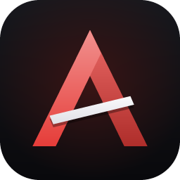
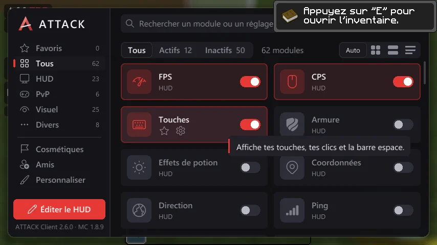
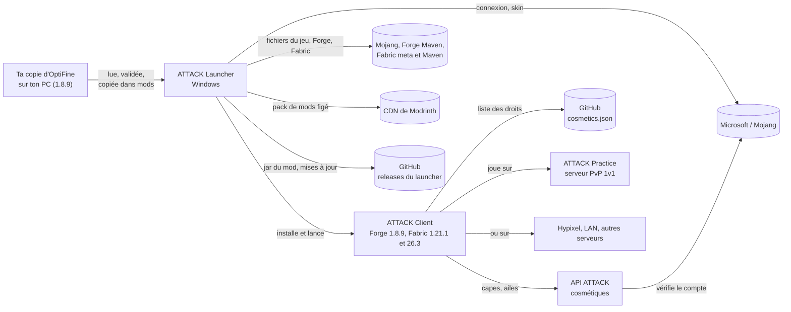

<p align="center">
  
</p>

<h1 align="center">ATTACK Launcher</h1>

<p align="center">
  Le launcher Windows d'<strong>ATTACK Client</strong> : Minecraft PvP installé et lancé en un clic, en 1.8.9, 1.21.1 et 26.3.
</p>

<p align="center">
  <a href="https://7shiki3.github.io/attack-launcher/">Site</a> ·
  <a href="https://github.com/7ShIkI3/attack-launcher/releases/latest">Télécharger pour Windows</a> ·
  <a href="docs/wiki/Home.md">Wiki</a> ·
  <a href="https://7shiki3.github.io/attack-launcher/en/">English</a>
</p>

<p align="center">
  <a href="https://github.com/7ShIkI3/attack-launcher/releases/latest"></a>
</p>


## Ce que fait le launcher

ATTACK Client est un mod de PvP (Forge en 1.8.9, Fabric en 1.21.1 et 26.3). Pour le jouer, il faut normalement installer
Minecraft, le chargeur de mods et le bon jar au bon endroit, sans mélanger avec tes autres mods. Le launcher fait tout ça à
ta place :

- **Trois profils indépendants** : 1.8.9 (Forge), 1.21.1 et 26.3 (Fabric). Chacun a son dossier de jeu, son état
  d'installation, son Java et ses réglages ; tu peux garder les trois.
- **Tout s'installe en un clic (INSTALLER)** : Minecraft, le chargeur de mods, le pack de mods du profil et le mod ATTACK
  Client, dans un dossier de jeu séparé de ton `.minecraft`. Chaque fichier téléchargé est vérifié par son empreinte (hash).
- **Un pack de mods par profil, réglable** : les trois profils ont un pack figé (Phosphor Legacy et Client Side Sounds en
  1.8.9 ; Fabric API, Sodium, Lithium et d'autres en 1.21.1 et 26.3). Des groupes s'activent ou se coupent dans les
  Réglages : **Mods PvP (latence)** et **Packs OptiFine** (activés par défaut, profils Fabric), **Replay Mod** (coupé, les
  trois profils) et **Shaders (Iris)** (coupé, profils Fabric). Ils s'appliquent à la prochaine installation.
- **OptiFine en 1.8.9, avec ta propre copie** : le launcher repère l'OptiFine que tu as téléchargé (ou celui que tu
  choisis), le valide, puis le copie dans le dossier `mods` du profil. Il ne le télécharge jamais.
- **Connexion Microsoft par code d'appareil** (le launcher ne voit jamais ton mot de passe). Avec un compte connecté,
  **JOUER** lance directement le jeu, avec le Java officiel de Mojang adapté au profil (Java 8, 21 ou 25) ; sans compte, il
  ouvre le launcher Minecraft officiel sur le profil ATTACK choisi.
- **Skin en 3D, français et anglais** : la page Compte affiche ton skin et permet d'en changer ; la langue du launcher se
  règle dans les Réglages.
- **Mises à jour automatiques** : la version installée télécharge les nouvelles versions en arrière-plan, vérifie leur
  SHA-512 et n'installe jamais rien pendant une partie.
- **Transparent** : le code est visible, les adresses contactées sont une liste fixe, et le launcher n'envoie aucune
  statistique (voir [Vie privée et sécurité](docs/wiki/Vie-privee-et-securite.md)).

| Profil | Minecraft | Chargeur | Java | Pack de mods | Dossier de jeu |
| --- | --- | --- | --- | --- | --- |
| **1.8.9** (profil « ATTACK Client », inchangé) | 1.8.9 | Forge 11.15.1.2318 | 8 | Phosphor Legacy, Client Side Sounds, et OptiFine (ta copie) | `%APPDATA%\.attack` |
| **1.21.1** (profil « ATTACK 1.21.1 ») | 1.21.1 | Fabric Loader 0.19.5 | 21 | Fabric API, Sodium, Lithium… et les groupes réglables | `%APPDATA%\.attack\profiles\fabric-1.21.1` |
| **26.3** (profil « ATTACK 26.3 ») | 26.3 | Fabric Loader 0.19.5 | 25 | Fabric API, Sodium, Lithium… et les groupes réglables | `%APPDATA%\.attack\profiles\fabric-26.3` |

Les profils sont indépendants : chacun a son dossier de jeu, son état d'installation et ses réglages (dossier de jeu,
Java, arguments Java, groupes du pack, OptiFine en 1.8.9). Le profil 1.8.9 garde son identifiant officiel (« ATTACK
Client ») et son dossier de jeu : un joueur qui l'utilisait déjà ne perd rien.

## Captures

<table>
  <tr>
    <td align="center"><br><sub>Accueil, profil 26.3 (Fabric) : ligne « Tout est prêt », nouveautés et profil actuel</sub></td>
    <td align="center"><br><sub>Page Mods, profil 1.8.9 : le mod ATTACK, OptiFine (ta copie) et le pack Forge</sub></td>
  </tr>
  <tr>
    <td align="center"><br><sub>Page Mods, profil 26.3 : pack figé, jars vérifiés par SHA-512, Iris en option</sub></td>
    <td align="center"><br><sub>Réglages en trois onglets (ici « Ce profil » en 1.8.9) : mémoire, Java, OptiFine, pack de mods</sub></td>
  </tr>
  <tr>
    <td align="center"><br><sub>Compte Microsoft et skin en 3D</sub></td>
    <td align="center"><br><sub>Historique des versions, filtrable (Tout, Launcher, ATTACK Client)</sub></td>
  </tr>
</table>

<p align="center">
  <br>
  <sub>Le nouveau menu ATTACK en jeu, en 1.8.9</sub>
</p>

Les captures du launcher montrent un compte factice (« Raphael ») avec un skin de test.

## Démarrage rapide

1. Ouvre la page [Releases](https://github.com/7ShIkI3/attack-launcher/releases/latest) et télécharge :
   - `ATTACK-Launcher-Setup-x.y.z.exe` : installateur classique (raccourci dans le menu Démarrer) ;
   - ou `ATTACK-Launcher-Portable-x.y.z.exe` : version portable, sans installation.
2. Lance le fichier. Tu dois posséder Minecraft Java Edition. Le launcher Minecraft officiel n'est nécessaire que pour le
   mode « sans compte » (JOUER l'ouvre alors sur le profil ATTACK choisi).
3. Choisis ton profil (**1.8.9**, **1.21.1** ou **26.3**) au-dessus du bouton, puis clique sur **INSTALLER**. Chaque
   profil s'installe séparément.
4. Pour jouer :
   - **avec un compte connecté** (page **Compte**, bouton « Ajouter un compte Microsoft ») : **JOUER** lance
     directement ATTACK Client dans le profil choisi ;
   - **sans compte** : **JOUER** ouvre le launcher officiel avec le profil du même nom (« ATTACK Client »,
     « ATTACK 1.21.1 » ou « ATTACK 26.3 ») en tête de liste.
5. Pour régler le pack de mods, va dans **Réglages**, onglet **Ce profil** (ou clique sur **Régler** sur l'accueil) :
   active ou coupe **Mods PvP (latence)**, **Packs OptiFine**, **Replay Mod** et **Shaders (Iris)**. Un réglage du pack
   s'applique à la prochaine installation : un bandeau « À appliquer » propose **Installer maintenant**.
6. En 1.8.9, si tu as déjà OptiFine, le launcher le trouve tout seul ; sinon, **Choisir le fichier…** dans la carte
   OptiFine (voir la FAQ ci-dessous).

## Questions fréquentes

**Windows affiche « Windows a protégé votre ordinateur » (SmartScreen).** Le `.exe` n'est **pas signé** (un certificat de
signature de code coûte cher pour un projet gratuit). Clique sur **Informations complémentaires**, vérifie que le fichier
vient bien de la page Releases de ce dépôt, puis sur **Exécuter quand même**. Si tu veux, compare avec le SHA-256 affiché
sur la release :

```powershell
Get-FileHash .\ATTACK-Launcher-Setup-x.y.z.exe -Algorithm SHA256
```

**OptiFine est-il inclus ?** Non : sa licence interdit de le redistribuer, donc le launcher **ne le télécharge jamais**. En
1.8.9, il utilise **ta copie**, que tu récupères toi-même sur [optifine.net](https://optifine.net/downloads). Il la cherche dans
`.minecraft\libraries\optifine` puis dans `.minecraft\mods`, ou tu choisis le fichier avec **Choisir le fichier…** ; il la
valide, puis la copie dans le dossier `mods` du profil. Si le launcher n'en trouve aucune, le jeu marche sans OptiFine et un
bouton ouvre optifine.net dans ton navigateur. En 1.21.1 et 26.3, le groupe **Packs OptiFine** (Continuity, Entity Texture
Features, Entity Model Features) lit les packs de ressources au format OptiFine sans OptiFine.

**Les mods PvP sont-ils autorisés sur mon serveur ?** Ça dépend du serveur : lis ses règles. Sur les profils Fabric, le
groupe **Mods PvP (latence)** (Crystal Optimizer, Anchor Optimizer, WalksyLib, BetterHitReg, Complete Shield Fixes) est activé
par défaut ; ils ne changent que ce que le client affiche ou anticipe, et sont à couper sur un serveur qui les interdit :
désactive le groupe dans les Réglages, puis clique sur **INSTALLER** pour les retirer. En 1.8.9, **Saut sans délai** (No Jump
Delay) et **Coups sans délai** (No Hit Delay) sont actifs par défaut sur tous les serveurs : ils sont interdits et détectés sur
beaucoup de serveurs publics (Hypixel par exemple), à couper là-bas depuis le menu ATTACK. **Perspective** est interdit sur
Hypixel. La page **Mods** le rappelle aussi dans la description de ces modules.

**Installateur ou portable ?** L'installateur (`Setup.exe`) met un raccourci dans le menu Démarrer, télécharge les nouvelles
versions tout seul et affiche une bannière « Redémarrer ». La version portable n'a pas besoin d'installation, mais elle ne
peut pas se remplacer elle-même : elle affiche « Nouvelle version disponible » avec un lien vers la page Releases. Dans les
deux cas, rien n'est installé pendant une partie. Détails : [Installation et mises à jour](docs/wiki/Installation-et-mises-a-jour.md).

## Pour aller plus loin

<details>
<summary>Comment ça marche</summary>



- Le launcher est une application **Electron** : un processus principal (qui fait tout le travail : réseau,
  fichiers, comptes) et une page d'interface isolée qui ne fait que l'afficher.
- **Installer** : il télécharge Minecraft, ses bibliothèques et ses ressources chez Mojang, puis le chargeur du profil :
  Forge chez Maven Forge (l'installateur Forge est lu comme une archive, jamais exécuté) ou Fabric Loader 0.19.5
  (profil publié par `meta.fabricmc.net`, validé strictement, bibliothèques de `maven.fabricmc.net`). Il ajoute ensuite le
  **pack de mods figé** du profil, **pour les trois profils** (adresses `cdn.modrinth.com` écrites dans le dépôt,
  vérifiées par SHA-512 : le launcher n'appelle jamais l'API Modrinth), puis, en 1.8.9, la copie d'OptiFine du joueur, et enfin
  le jar du mod dans la dernière release GitHub de ce dépôt. Chaque fichier téléchargé est vérifié par son hash.
- **Groupes du pack** : Mods PvP, Packs OptiFine, Replay Mod et Shaders (Iris) s'activent par profil. Un jar posé par le
  launcher qui sort du pack (groupe coupé, version changée) est retiré à l'installation suivante ; les jars que tu ajoutes
  toi-même dans `mods` ne sont jamais touchés.
- **OptiFine (1.8.9)** : le launcher ne fait que **copier** ton OptiFine, après l'avoir validé (archive ZIP lisible,
  manifeste d'OptiFine pour Forge, nom contenant 1.8.9). La copie est suivie dans l'état d'installation : quand tu coupes le
  réglage, seule la copie du launcher est retirée (jamais un OptiFine que tu as mis toi-même dans `mods`) ; si ta copie
  d'origine disparaît, le jar déjà copié reste dans `mods` et le profil reste prêt.
- **Langue de départ** : la langue du launcher est écrite dans `options.txt` seulement quand le launcher crée ce fichier
  (dossier de jeu neuf) ; un `options.txt` existant garde sa langue.
- **Se connecter** : connexion Microsoft par « code d'appareil » (le launcher ne voit jamais ton mot de passe),
  puis Xbox Live et les services Minecraft. Le jeton de renouvellement est chiffré par Windows.
- **Jouer** : avec un compte, le launcher installe le Java officiel de Mojang adapté au profil (Java 8, 21 ou 25) et
  lance le jeu lui-même ; sans compte, il ouvre le launcher officiel sur le profil ATTACK choisi.
- **Se mettre à jour** : il regarde les releases GitHub de ce dépôt, vérifie le SHA-512 du nouvel installateur, et
  n'installe jamais rien pendant une partie.

Détail complet : [Architecture](docs/wiki/Architecture.md).

</details>

<details>
<summary>Vie privée : ce que le launcher envoie et garde</summary>

Ce tableau décrit **le launcher** (pas le mod ATTACK Client ni le jeu Minecraft lui-même). Chaque ligne a été
vérifiée dans le code ; les références `fichier:ligne` sont dans
[Vie privée et sécurité](docs/wiki/Vie-privee-et-securite.md).

| Donnée | Où elle va | Pourquoi | Durée |
| --- | --- | --- | --- |
| Mot de passe Microsoft | Nulle part chez nous : tu le saisis sur le site de Microsoft, le launcher ne le voit jamais | Connexion par code d'appareil | Sans objet |
| Jeton de renouvellement Microsoft | Reçu de Microsoft ; gardé sur ton PC dans `accounts.json`, **chiffré par Windows** (DPAPI) | Rester connecté sans retaper de code | Jusqu'à ce que tu cliques **Déconnecter** |
| Jeton Minecraft | **Mémoire du launcher seulement**, jamais écrit sur disque ; envoyé aux services Minecraft (profil, skin) et passé au jeu au lancement ; masqué dans les journaux | Lancer le jeu, lire ou changer le skin | Le temps que le launcher tourne |
| Pseudo, UUID, skin (image et modèle de bras) | Lus chez Mojang (`api.minecraftservices.com`, `textures.minecraft.net`) ; copie dans `accounts.json` (en clair, sans jeton) | Afficher ton compte et ton skin en 3D | Jusqu'à **Déconnecter** |
| Skin PNG que tu choisis | Lu sur ton disque, gardé en mémoire ; envoyé à Mojang **seulement** si tu cliques « Appliquer ce skin » | Changer de skin | Jusqu'à l'envoi ou l'abandon |
| Copie d'OptiFine 1.8.9 (le `.jar` que tu as récupéré) | Lue sur ton disque (`.minecraft\libraries\optifine`, `.minecraft\mods` ou le fichier que tu choisis), validée, puis copiée dans le dossier `mods` du profil 1.8.9 ; **jamais envoyée**. Le launcher ne fait aucune requête vers optifine.net : le site s'ouvre dans ton navigateur seulement si tu cliques | Que les packs de ressources retrouvent textures connectées, ciel et mobs | Tant que le réglage OptiFine est actif ; coupé, la copie du launcher est retirée à l'installation suivante |
| Requêtes de téléchargement (adresse IP, en-tête `User-Agent: ATTACK-Launcher (+URL du dépôt)`) | Mojang, Maven Forge, Fabric (`meta.fabricmc.net`, `maven.fabricmc.net`), CDN de Modrinth, GitHub, Microsoft : les serveurs qui reçoivent toute requête voient ton IP | Installer le jeu, se connecter, se mettre à jour | Selon ces services (non vérifié) |
| Vérification des mises à jour | GitHub (releases de ce dépôt), au démarrage puis toutes les 6 h, sans jeton ni identifiant | Savoir si une version plus récente existe | Selon GitHub (non vérifié) |
| Réglages (mémoire, profil choisi, langue, mode développeur, ID client Azure ; par profil : dossier de jeu, Java, arguments Java, dossier des jars de test, groupes du pack — Mods PvP, Packs OptiFine, Replay Mod, Shaders — et OptiFine avec le chemin du fichier choisi, `optifineJar`) | `settings.json` sur ton PC, jamais envoyés | Garder tes choix | Jusqu'à suppression du fichier |
| Journaux (mises à jour, sortie du jeu) | Fichiers sur ton PC (`updater.log`, `game-*.log`), jamais envoyés | Dépanner | Le journal des mises à jour est tourné au-delà de 1 Mo ; les journaux de jeu ne sont pas supprimés par le launcher |

**Jamais collecté** : aucune télémétrie, statistique d'usage, rapport de plantage, identifiant d'installation ou de
machine, publicité : le code ne contient rien de tel (recherche faite dans `src/` et `scripts/`). L'interface
n'a de toute façon pas le droit de faire de requête réseau (politique CSP `connect-src 'none'`). Le launcher ne
contacte **pas** l'API ATTACK ni l'API de Modrinth : seules des adresses de Mojang, Microsoft/Xbox, Forge, Fabric, du
CDN de Modrinth (fichiers figés) et de GitHub sont autorisées.

**Dans le jeu, pas dans le launcher** : WalksyLib (mod PvP du pack Fabric) interroge `api.modrinth.com` au démarrage du jeu
pour chercher des mises à jour. Le launcher écrit une fois sa configuration de départ pour couper cette vérification, seulement
si ce fichier n'existe pas ; tu peux la rallumer dans les réglages de WalksyLib. Mod Menu et Crystal Optimizer ont chacun leur
propre vérification de mises à jour, laissée telle quelle.

**Refuser ou effacer** : n'ajoute aucun compte (JOUER passe alors par le launcher officiel) ; clique
**Déconnecter** pour effacer un compte et son jeton chiffré ; désinstalle le launcher et supprime `%APPDATA%\ATTACK Launcher`,
`%LOCALAPPDATA%\ATTACK Launcher` et `%LOCALAPPDATA%\attack-launcher-updater`. Pour effacer aussi le jeu ATTACK, supprime
`%APPDATA%\.attack` (mod, mondes, captures, journaux du jeu) et, dans `%APPDATA%\.minecraft`, le profil « ATTACK … » de
`launcher_profiles.json` (et sa copie `launcher_profiles.json.bak`) ainsi que les dossiers de versions Forge ou Fabric installés
par le launcher. Minecraft lui-même (ses versions, `libraries` et `assets` dans `.minecraft`) est partagé avec le launcher
officiel : ne le supprime que si tu n'en as plus besoin. Il n'existe pas d'option pour couper la vérification des mises à jour
(la version portable la fait aussi) : seul un pare-feu l'empêche.

</details>

<details>
<summary>Pour les développeurs</summary>

Node.js 22.12 ou plus récent (`package.json` déclare `node >= 20` pour les scripts hors Electron).

```bash
npm install
npm start
npm test
npm run site
npm run site:serve
```

| Commande | Rôle |
| --- | --- |
| `npm start` | Lance le launcher depuis les sources |
| `npm test` | Tests unitaires, sans réseau |
| `npm run install-test -- [dossier] [--profile <id>]` | Installation **réelle** d'un profil dans un dossier temporaire, puis recontrôle de tous les hash |
| `npm run launch-test -- <dossier> [--profile <id>]` | Lancement direct **réel** jusqu'à l'écran titre |
| `npm run update-test -- <dossier>` | Mise à jour **réelle** de bout en bout, sans GitHub |
| `npm run screenshot -- <dossier>` | Capture chaque page du launcher |
| `npm run dist` | Construit l'installateur et la version portable dans `dist/` (ne publie rien) |
| `npm run site` | Construit le site web du projet (son code est dans `site/`) |
| `npm run site:serve` | Sert le site en local, pour le relire avant de publier |
| `npm run site:images -- --sources <dossier>` | Produit les images WebP du site à partir d'un dossier de captures PNG : le dossier est obligatoire, et ces PNG ne sont pas dans le dépôt |

Toutes les commandes, les scripts de test réels et la procédure de publication sont dans le wiki
([Développement](docs/wiki/Developpement.md), [Publier une version](docs/wiki/Publier-une-version.md)).

</details>

## Wiki

| Page | Contenu |
| --- | --- |
| [Sommaire](docs/wiki/Home.md) | Point d'entrée du wiki |
| [Architecture](docs/wiki/Architecture.md) | Processus principal, page, IPC, schémas, organisation du code |
| [Fonctionnalités](docs/wiki/Fonctionnalites.md) | Les quatre pages du launcher, profils, réglages, mode développeur, profil officiel |
| [Installation et mises à jour](docs/wiki/Installation-et-mises-a-jour.md) | Ce qui est installé et où pour chaque profil, pack de mods et ses groupes, OptiFine en 1.8.9, vérification des hash, mises à jour automatiques |
| [Comptes et skin](docs/wiki/Comptes-et-skin.md) | Connexion Microsoft, stockage des jetons, skin 3D |
| [Vie privée et sécurité](docs/wiki/Vie-privee-et-securite.md) | Version détaillée, avec références dans le code |
| [Développement](docs/wiki/Developpement.md) | Commandes npm, tests, captures d'écran, site web |
| [Publier une version](docs/wiki/Publier-une-version.md) | Release du launcher et des jars du mod (Forge et Fabric), packs de mods, app Azure, site |
| [Capes réservées](docs/wiki/Capes-reservees.md) | Donner une cape réservée via `cosmetics/cosmetics.json` |
| [Dépannage](docs/wiki/Depannage.md) | SmartScreen, erreurs de connexion, d'installation, de mise à jour |

## Licences et mentions

- Le launcher : **Tous droits réservés** (voir [LICENSE](LICENSE)) : le code est visible pour la transparence, mais ce n'est pas de l'open source. Tu peux utiliser les versions officielles ; copier, modifier, republier ou vendre ce travail demande l'accord écrit de l'auteur. Les versions publiées avant le 19 octobre 2026 restaient sous MIT.
- Mods des packs : ils appartiennent à leurs auteurs et restent sous leur licence. ATTACK Launcher les télécharge sans les modifier depuis leur page officielle sur Modrinth et vérifie chaque fichier par son empreinte SHA-512. La liste avec auteur, version et licence est dans le launcher (Réglages, onglet **Launcher**, bouton **Mods et licences**) et dans la section crédits du [site](https://7shiki3.github.io/attack-launcher/).
- OptiFine appartient à **sp614x** : le launcher ne l'embarque ni ne le télécharge, il utilise seulement la copie que tu as récupérée toi-même sur optifine.net. Il n'est jamais redistribué.
- Vue 3D du skin : **skinview3d** et **three.js**, licence MIT (`src/renderer/vendor/LICENSE-*.txt`).
- Polices **Inter** et **Montserrat** : SIL Open Font License 1.1 (`src/renderer/fonts/OFL-*.txt`).
- À l'exécution, une seule dépendance : `electron-updater` (mise à jour du launcher). Outils de développement :
  `electron` et `electron-builder`.
- Minecraft est une marque de Mojang AB / Microsoft. ATTACK Launcher est un projet indépendant, ni approuvé
  ni affilié à Mojang ou Microsoft. Les fichiers du jeu sont téléchargés depuis les serveurs officiels de Mojang ;
  il faut posséder Minecraft Java Edition pour jouer.
