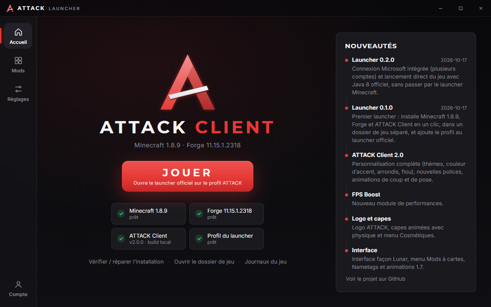

# ATTACK Launcher

Launcher Windows d'**ATTACK Client**, le client PvP pour Minecraft 1.8.9 (Forge).
En un clic, il installe Minecraft 1.8.9, Forge 1.8.9-11.15.1.2318 et le mod ATTACK Client.
Avec un compte Microsoft connecté, **JOUER** lance directement le jeu ; sans compte, il ouvre le
**launcher Minecraft officiel** sur un profil « ATTACK Client » prêt à l'emploi.



## Installation

1. Ouvre la page [Releases](https://github.com/7ShIkI3/attack-launcher/releases) et télécharge :
   - `ATTACK-Launcher-Setup-x.y.z.exe` : installateur classique (raccourci dans le menu Démarrer) ;
   - ou `ATTACK-Launcher-Portable-x.y.z.exe` : version portable, sans installation.
2. Lance le fichier. Le launcher Minecraft officiel doit déjà être installé (version Xbox / Microsoft Store
   ou ancienne version) et tu dois posséder Minecraft Java Edition.
3. Clique sur **INSTALLER**.
4. Pour jouer :
   - **avec un compte connecté** (page **Compte**) : **JOUER** lance directement ATTACK Client ;
   - **sans compte** : **JOUER** ouvre le launcher officiel avec le profil « ATTACK Client » en tête de liste.

## Connexion Microsoft

Page **Compte** → **Ajouter un compte Microsoft**. Le launcher affiche un **code** et ouvre la page
Microsoft (`microsoft.com/link`) : saisis-y le code puis connecte-toi. **Le launcher ne voit jamais ton mot
de passe** : la connexion se fait sur le site de Microsoft (connexion par « code d'appareil »).

Ensuite, le launcher enchaîne Xbox Live, XSTS et les services Minecraft, vérifie que le compte possède
Minecraft Java (achat ou Game Pass) et récupère ton pseudo et ta skin. Tu peux ajouter **plusieurs comptes**,
choisir le compte actif et te déconnecter.

- Le jeton de renouvellement (refresh token) est **chiffré par Windows** (DPAPI, via `safeStorage`) dans
  `%APPDATA%ATTACK Launcheraccounts.json` : seul ton compte Windows peut le relire. Il est renouvelé tout seul.
- Aucun jeton n'apparaît dans les journaux : la ligne de commande enregistrée masque `--accessToken`.

Messages d'erreur courants : pas de profil Xbox (connecte-toi une fois sur xbox.com), compte enfant
(à ajouter à une famille Microsoft), jeu non possédé, code expiré, ou **« app Azure pas encore validée par
Mojang »** (voir ci-dessous).

### Créer l'app Azure (une seule fois, pour qui publie le launcher)

Mojang exige que chaque launcher utilise **sa propre application Azure, validée par Mojang**. Tant qu'elle
n'est pas validée, la connexion échoue à l'étape Minecraft (erreur 403 « Invalid app registration »).

1. Sur [portal.azure.com](https://portal.azure.com) : **Inscriptions d'applications** → **Nouvelle inscription**.
2. Nom : « ATTACK Launcher » ; types de comptes : **Comptes Microsoft personnels uniquement** ; pas d'URI de redirection.
3. Dans **Authentification** : **Autoriser les flux de clients publics** = **Oui**, puis **Enregistrer**.
4. Copie l'**ID d'application (client)** (format `xxxxxxxx-xxxx-xxxx-xxxx-xxxxxxxxxxxx`) dans
   **Réglages → ID client Azure** du launcher, ou dans la variable d'environnement `ATTACK_MS_CLIENT_ID`.
   Ce n'est **pas un secret** : aucune clé secrète n'est nécessaire (client public).
5. Demande l'accès de cette app à l'API Minecraft avec le formulaire Mojang :
   [aka.ms/mce-reviewappid](https://aka.ms/mce-reviewappid), puis attends leur réponse (plusieurs jours
   à quelques semaines).

### Lancement direct

- **Java 8** : runtime officiel `jre-legacy` de Mojang, téléchargé fichier par fichier depuis le manifeste du
  launcher officiel (SHA-1 vérifié), dans `%LOCALAPPDATA%ATTACK Launcher
untime`. Un Java personnalisé
  (Réglages → Java) est utilisé à la place s'il est choisi.
- Natives extraites, classpath Forge + Minecraft 1.8.9, mémoire prise dans les Réglages, configuration log4j de
  Mojang (qui corrige aussi la faille Log4Shell).
- La sortie du jeu va dans `%APPDATA%.attacklogslaunchergame-*.log` (lien **Journaux du jeu** sur l'accueil).

### ⚠️ Avertissement Windows SmartScreen

Le `.exe` n'est **pas signé** (un certificat de signature de code coûte cher pour un projet gratuit).
Au premier lancement, Windows peut afficher **« Windows a protégé votre ordinateur »**. Pour continuer :
clique sur **Informations complémentaires**, vérifie que l'éditeur est inconnu et que le fichier vient bien
de la page Releases de ce dépôt, puis clique sur **Exécuter quand même**.

Ne télécharge le launcher **que** depuis la page Releases de ce dépôt. Tu peux comparer l'empreinte
SHA-256 affichée sur la release avec celle de ton fichier :

```powershell
Get-FileHash .\ATTACK-Launcher-Setup-x.y.z.exe -Algorithm SHA256
```

## Ce que fait le launcher (et où vont les fichiers)

| Élément | Emplacement |
| --- | --- |
| Minecraft 1.8.9 (JSON, jar, bibliothèques, ressources) | `%APPDATA%\.minecraft\versions\1.8.9`, `libraries`, `assets` |
| Forge 1.8.9-11.15.1.2318 | `%APPDATA%\.minecraft\versions\1.8.9-forge1.8.9-11.15.1.2318-1.8.9` |
| Dossier de jeu séparé (mods, réglages, captures, mondes) | `%APPDATA%\.attack` (modifiable dans Réglages) |
| Mod ATTACK Client | `%APPDATA%\.attack\mods\attack-client.jar` |
| Profil « ATTACK Client » | fusionné dans `%APPDATA%\.minecraft\launcher_profiles.json` |

- Le **dossier de jeu séparé** évite tout mélange avec les autres mods de ton `.minecraft`.
- `launcher_profiles.json` est **fusionné** : tes autres profils et réglages restent intacts, et l'ancien
  fichier est sauvegardé en `launcher_profiles.json.bak` avant chaque écriture. Ferme le launcher officiel
  pendant l'installation : il peut réécrire ce fichier.
- Réglages : mémoire (-Xmx), dossier de jeu, Java (celui fourni par Minecraft par défaut), langue FR/EN,
  ID client Azure, mode développeur.
- **Vérifier / réparer l'installation** recontrôle chaque fichier et ne retélécharge que ce qui manque ou est abîmé.

## Sécurité

- Sources de téléchargement limitées à : Mojang (`piston-meta`, `piston-data`, `launcher`, `launchermeta`,
  `libraries.minecraft.net`, `resources.download.minecraft.net`), Maven Forge (`maven.minecraftforge.net`)
  les releases GitHub de ce dépôt, et pour la connexion : `login.microsoftonline.com`,
  `user.auth.xboxlive.com`, `xsts.auth.xboxlive.com`, `api.minecraftservices.com`, `textures.minecraft.net`.
  Toute autre adresse, y compris après une redirection, est refusée.
- Chaque fichier est vérifié : SHA-1 publié par Mojang ou par Maven (`.sha1`), SHA-256 pour le mod.
  Un fichier au mauvais hash est supprimé.
- L'installateur Forge est **lu comme une archive ZIP** (on y prend `install_profile.json` et le jar
  universal) : il n'est **jamais exécuté**.
- Fenêtre Electron isolée : `contextIsolation`, `sandbox`, pas de `nodeIntegration`, politique CSP stricte,
  et la page ne parle au processus principal que par une liste fixe d'appels nommés.

## Développement

Prérequis : Node.js 22.12 ou plus récent.

```bash
npm install
```

```bash
npm start
```

| Commande | Rôle |
| --- | --- |
| `npm test` | tests unitaires (`node:test`, sans réseau) : manifestes, install_profile, chemins Maven, profils, téléchargements, connexion Microsoft simulée, comptes, ligne de commande Java, runtime |
| `npm run install-test` | installation **réelle** complète dans un dossier temporaire, puis contre-vérification de tous les hash |
| `npm run launch-test -- <dossier>` | lancement direct **réel** avec un compte hors ligne factice, jusqu'à l'écran titre |
| `npm run screenshot -- <dossier>` | ouvre l'app dans des dossiers isolés et capture chaque page |
| `npm run icons` | régénère les icônes PNG à partir des polygones du logo |
| `npm run dist` | construit `dist/ATTACK-Launcher-Setup-*.exe` (NSIS) et `dist/ATTACK-Launcher-Portable-*.exe` |

La logique (`src/main/*.js` sauf `main.js` et `preload.js`) n'utilise pas Electron : elle se teste avec Node seul.

### Mode développeur

Tant qu'aucune release du mod n'est publiée, active **Réglages → Mode développeur** : le launcher copie le
dernier `attack-client-*.jar` du dossier indiqué (par défaut `Documents\pvp-essentials\build\libs`,
ou la variable d'environnement `ATTACK_DEV_JAR_DIR`).

Le mode développeur permet aussi d'ajouter un **compte hors ligne** (pseudo seul, jeton « 0 ») pour tester
le lancement direct en solo, sans compte Microsoft. Les serveurs en ligne refusent ce type de compte.

### Publier le mod

Le launcher prend le jar `attack-client*.jar` de la **dernière release** GitHub de ce dépôt et exige son
SHA-256 : celui que GitHub calcule pour chaque fichier de release, ou à défaut un fichier
`attack-client-x.y.z.jar.sha256` joint à la release. Sans SHA-256, l'installation est refusée.

## Dépendances

Aucune dépendance à l'exécution. Outils de développement : `electron` et `electron-builder`.

## Licences et mentions

- Polices **Inter** et **Montserrat** : SIL Open Font License 1.1 (`src/renderer/fonts/OFL-*.txt`).
- Minecraft est une marque de Mojang AB / Microsoft. ATTACK Launcher est un projet indépendant, ni approuvé
  ni affilié à Mojang ou Microsoft. Les fichiers du jeu sont téléchargés depuis les serveurs officiels de Mojang ;
  il faut posséder Minecraft Java Edition pour jouer.
