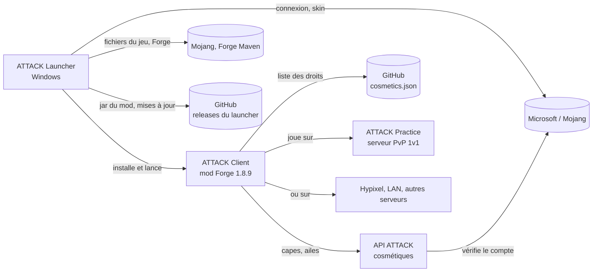

# ATTACK Launcher


Launcher Windows d'**ATTACK Client**, le client PvP pour Minecraft 1.8.9 (Forge). En un clic, il installe
Minecraft 1.8.9, Forge 1.8.9-11.15.1.2318 et le mod ATTACK Client. Avec un compte Microsoft connecté, **JOUER**
lance directement le jeu ; sans compte, il ouvre le **launcher Minecraft officiel** sur un profil « ATTACK Client »
prêt à l'emploi.

## Le but

ATTACK Client est un mod Forge : pour le jouer, il faut normalement installer Minecraft 1.8.9, Forge et le bon
jar dans le bon dossier, sans mélanger avec tes autres mods. Ce launcher fait tout ça à ta place, pour les
joueurs de PvP 1.8.9 qui veulent un client prêt à jouer, sans se soucier de la mise en place.

Il est conçu pour rester simple à contrôler : le code est ouvert, chaque fichier téléchargé est vérifié par son
empreinte (hash), les adresses contactées sont une liste fixe, et il n'envoie aucune statistique (voir
[Vie privée](#vie-privée)).

## Comment ça marche



- Le launcher est une application **Electron** : un processus principal (qui fait tout le travail : réseau,
  fichiers, comptes) et une page d'interface isolée qui ne fait que l'afficher.
- **Installer** : il télécharge Minecraft 1.8.9, ses bibliothèques et ses ressources chez Mojang, Forge chez Maven
  Forge (l'installateur Forge est lu comme une archive, jamais exécuté) et le jar du mod dans la dernière release
  GitHub de ce dépôt. Chaque fichier est vérifié par son hash.
- **Se connecter** : connexion Microsoft par « code d'appareil » (le launcher ne voit jamais ton mot de passe),
  puis Xbox Live et les services Minecraft. Le jeton de renouvellement est chiffré par Windows.
- **Jouer** : avec un compte, le launcher installe le Java 8 officiel de Mojang et lance le jeu lui-même ; sans
  compte, il ouvre le launcher officiel sur le profil « ATTACK Client ».
- **Se mettre à jour** : il regarde les releases GitHub de ce dépôt, vérifie le SHA-512 du nouvel installateur, et
  n'installe jamais rien pendant une partie.

Détail complet : [Architecture](docs/wiki/Architecture.md).

## Installation et utilisation

1. Ouvre la page [Releases](https://github.com/7ShIkI3/attack-launcher/releases) et télécharge :
   - `ATTACK-Launcher-Setup-x.y.z.exe` : installateur classique (raccourci dans le menu Démarrer) ;
   - ou `ATTACK-Launcher-Portable-x.y.z.exe` : version portable, sans installation.
2. Lance le fichier. Tu dois posséder Minecraft Java Edition. Le launcher Minecraft officiel n'est nécessaire que
   pour le mode « sans compte » (JOUER l'ouvre alors sur le profil ATTACK Client).
3. Clique sur **INSTALLER**.
4. Pour jouer :
   - **avec un compte connecté** (page **Compte**, bouton « Ajouter un compte Microsoft ») : **JOUER** lance
     directement ATTACK Client ;
   - **sans compte** : **JOUER** ouvre le launcher officiel avec le profil « ATTACK Client » en tête de liste.

**Avertissement Windows SmartScreen.** Le `.exe` n'est **pas signé** (un certificat de signature de code coûte cher
pour un projet gratuit). Au premier lancement, Windows peut afficher « Windows a protégé votre ordinateur » : clique
sur **Informations complémentaires**, vérifie que le fichier vient bien de la page Releases de ce dépôt, puis
sur **Exécuter quand même**. Compare si tu veux le SHA-256 affiché sur la release :

```powershell
Get-FileHash .\ATTACK-Launcher-Setup-x.y.z.exe -Algorithm SHA256
```

**Mises à jour.** Le launcher installé (`Setup.exe`) télécharge tout seul les nouvelles versions et affiche une
bannière « Redémarrer » ; la version portable affiche seulement un avis avec un lien vers la page Releases.
Rien n'est jamais installé pendant une partie. Détails : [Installation et mises à jour](docs/wiki/Installation-et-mises-a-jour.md).

**Pour les développeurs** (Node.js 22.12 ou plus récent) :

```bash
npm install
npm start
npm test
```

Toutes les commandes, les scripts de test réels et la procédure de publication sont dans le wiki
([Développement](docs/wiki/Developpement.md), [Publier une version](docs/wiki/Publier-une-version.md)).

## Vie privée

Ce tableau décrit **le launcher** (pas le mod ATTACK Client ni le jeu Minecraft lui-même). Chaque ligne a été
vérifiée dans le code ; les références `fichier:ligne` sont dans
[Vie privée et sécurité](docs/wiki/Vie-privee-et-securite.md).

| Donnée | Où elle va | Pourquoi | Durée |
| --- | --- | --- | --- |
| Mot de passe Microsoft | Nulle part chez nous : tu le saisis sur le site de Microsoft, le launcher ne le voit jamais | Connexion par code d'appareil | Sans objet |
| Jeton de renouvellement Microsoft | Reçu de Microsoft ; gardé sur ton PC dans `accounts.json`, **chiffré par Windows** (DPAPI) | Rester connecté sans retaper de code | Jusqu'à ce que tu cliques **Déconnecter** |
| Jeton Minecraft | **Mémoire du launcher seulement**, jamais écrit sur disque ; envoyé aux services Minecraft (profil, skin) et passé au jeu au lancement ; masqué dans les journaux | Lancer le jeu, lire ou changer le skin | Le temps que le launcher tourne |
| Pseudo, UUID, skin (image et modèle de bras) | Lus chez Mojang (`api.minecraftservices.com`, `textures.minecraft.net`) ; copie dans `accounts.json` (en clair, sans jeton) | Afficher ton compte et ton skin en 3D | Jusqu'à **Déconnecter** |
| Skin PNG que tu choisis | Lu sur ton disque, gardé en mémoire ; envoyé à Mojang **seulement** si tu cliques « Appliquer ce skin » | Changer de skin | Jusqu'à l'envoi ou l'abandon |
| Requêtes de téléchargement (adresse IP, en-tête `User-Agent: ATTACK-Launcher (+URL du dépôt)`) | Mojang, Maven Forge, GitHub, Microsoft : les serveurs qui reçoivent toute requête voient ton IP | Installer le jeu, se connecter, se mettre à jour | Selon ces services (non vérifié) |
| Vérification des mises à jour | GitHub (releases de ce dépôt), au démarrage puis toutes les 6 h, sans jeton ni identifiant | Savoir si une version plus récente existe | Selon GitHub (non vérifié) |
| Réglages (mémoire, dossiers, Java, langue, ID client Azure) | `settings.json` sur ton PC, jamais envoyés | Garder tes choix | Jusqu'à suppression du fichier |
| Journaux (mises à jour, sortie du jeu) | Fichiers sur ton PC (`updater.log`, `game-*.log`), jamais envoyés | Dépanner | Le journal des mises à jour est tourné au-delà de 1 Mo ; les journaux de jeu ne sont pas supprimés par le launcher |

**Jamais collecté** : aucune télémétrie, statistique d'usage, rapport de plantage, identifiant d'installation ou de
machine, publicité : le code ne contient rien de tel (recherche faite dans `src/` et `scripts/`). L'interface
n'a de toute façon pas le droit de faire de requête réseau (politique CSP `connect-src 'none'`). Le launcher ne
contacte **pas** l'API ATTACK : seules des adresses de Mojang, Microsoft/Xbox, Forge et GitHub sont autorisées.

**Refuser ou effacer** : n'ajoute aucun compte (JOUER passe alors par le launcher officiel) ; clique
**Déconnecter** pour effacer un compte et son jeton chiffré ; désinstalle le launcher et supprime `%APPDATA%\ATTACK Launcher`,
`%LOCALAPPDATA%\ATTACK Launcher` et `%LOCALAPPDATA%\attack-launcher-updater`. Il n'existe pas d'option pour couper
la vérification des mises à jour (la version portable la fait aussi) : seul un pare-feu l'empêche.

## Wiki

| Page | Contenu |
| --- | --- |
| [Sommaire](docs/wiki/Home.md) | Point d'entrée du wiki |
| [Architecture](docs/wiki/Architecture.md) | Processus principal, page, IPC, schémas, organisation du code |
| [Fonctionnalités](docs/wiki/Fonctionnalites.md) | Les quatre pages du launcher, réglages, mode développeur, profil officiel |
| [Installation et mises à jour](docs/wiki/Installation-et-mises-a-jour.md) | Ce qui est installé et où, vérification des hash, mises à jour automatiques |
| [Comptes et skin](docs/wiki/Comptes-et-skin.md) | Connexion Microsoft, stockage des jetons, skin 3D |
| [Vie privée et sécurité](docs/wiki/Vie-privee-et-securite.md) | Version détaillée, avec références dans le code |
| [Développement](docs/wiki/Developpement.md) | Commandes npm, tests, captures d'écran |
| [Publier une version](docs/wiki/Publier-une-version.md) | Release du launcher et du mod, app Azure |
| [Capes réservées](docs/wiki/Capes-reservees.md) | Donner une cape réservée via `cosmetics/cosmetics.json` |
| [Dépannage](docs/wiki/Depannage.md) | SmartScreen, erreurs de connexion, d'installation, de mise à jour |

## Licences et mentions

- Le launcher est sous licence **MIT** (voir [LICENSE](LICENSE)).
- Vue 3D du skin : **skinview3d** et **three.js**, licence MIT (`src/renderer/vendor/LICENSE-*.txt`).
- Polices **Inter** et **Montserrat** : SIL Open Font License 1.1 (`src/renderer/fonts/OFL-*.txt`).
- À l'exécution, une seule dépendance : `electron-updater` (mise à jour du launcher). Outils de développement :
  `electron` et `electron-builder`.
- Minecraft est une marque de Mojang AB / Microsoft. ATTACK Launcher est un projet indépendant, ni approuvé
  ni affilié à Mojang ou Microsoft. Les fichiers du jeu sont téléchargés depuis les serveurs officiels de Mojang ;
  il faut posséder Minecraft Java Edition pour jouer.
