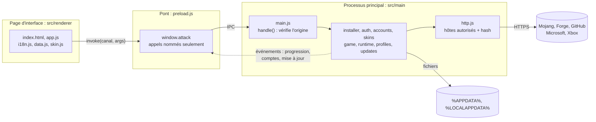
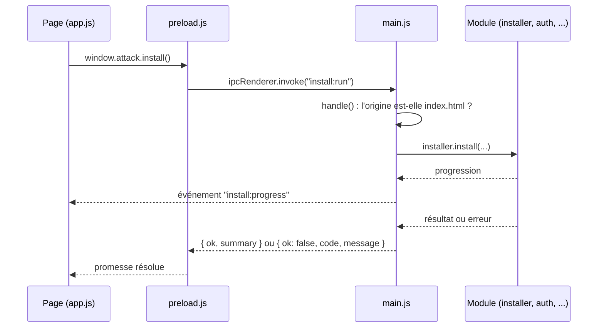
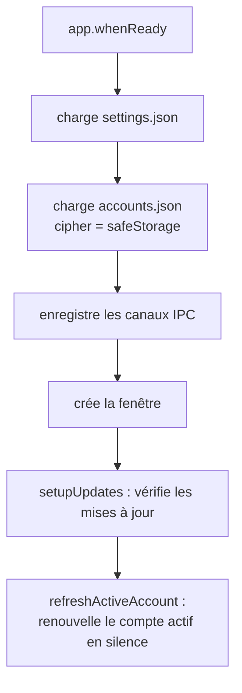
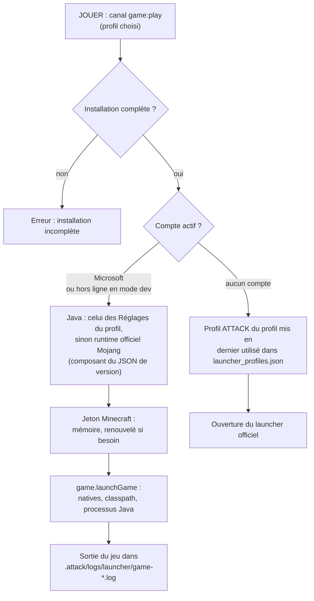

# Architecture

[← Sommaire](Home.md)

ATTACK Launcher est une application **Electron**. Elle se compose de deux mondes qui ne se parlent que par des
messages nommés :

- le **processus principal** (`src/main/`) : il a accès à Node.js, au réseau, aux fichiers et à Windows. C'est lui
  qui télécharge, vérifie, se connecte, lance le jeu et se met à jour ;
- la **page d'interface** (`src/renderer/`) : du HTML, du CSS et du JavaScript affichés dans une fenêtre
  isolée. Elle n'a **aucun** accès à Node.js, ni au réseau, ni aux jetons : elle affiche et envoie des demandes.

## Le processus principal (`src/main/`)

`main.js` crée la fenêtre, enregistre les canaux IPC et relie les modules. Tous les autres fichiers sont de la
**logique pure qui n'utilise pas Electron** : on la teste avec Node seul (`npm test`). Les parties qui dépendent du
réseau ou du chiffrement reçoivent leur dépendance en paramètre (un « transport » pour le réseau dans
`auth.js`, un `cipher` pour le chiffrement dans `accounts.js`), ce qui permet de les simuler dans les tests.

| Fichier | Rôle |
| --- | --- |
| `main.js` | Fenêtre, canaux IPC, chiffrement des jetons (`safeStorage`), enchaînement installation / lancement / mises à jour |
| `preload.js` | Pont `contextBridge` : expose `window.attack` avec des appels nommés, sans aucun accès à Node |
| `catalog.js` | **Catalogue des 3 profils** (Forge 1.8.9, Fabric 1.21.1, Fabric 26.3) : version de Minecraft, chargeur, dossier de jeu, profil officiel, règle exacte du jar ATTACK, pack. Module pur |
| `constants.js` | Adresses officielles, **liste des hôtes autorisés** (`ALLOWED_HOSTS`, Fabric et CDN Modrinth compris), URL de connexion ; alias des anciennes constantes du profil 1.8.9 |
| `http.js` | Téléchargements : hôtes autorisés, redirections vérifiées une à une, fichier `.part`, contrôle du hash |
| `installer.js` | Installation complète d'un profil (Minecraft, bibliothèques, assets, Forge **ou** Fabric, pack de mods, OptiFine du joueur, réglages de départ d'`options.txt`, configuration de WalksyLib, mod, profil) et état d'installation (`packGroups`, `optifine`) |
| `mojang.js` | Lecture des manifestes Mojang (version, bibliothèques, natives, index d'assets) |
| `forge.js`, `zip.js` | Lecture de l'installateur Forge **comme une archive ZIP** (jamais exécuté) |
| `fabric.js` | Profil de version de Fabric Loader : adresse de `meta.fabricmc.net`, validation stricte, plan de téléchargement, JSON de version écrit |
| `modpack.js` | Packs de mods figés (`src/main/packs/*.json`, un par profil) : validation (groupes `pvp`, `optifine`, `replay`, licence, auteur), installation dans `mods/`, jars gérés supprimés quand ils sortent du pack |
| `optifine.js` | **OptiFine du joueur** (profil 1.8.9) : détection de sa copie, validation (manifeste `TweakClass`), copie suivie dans l'état, retrait de la seule copie du launcher. Jamais de téléchargement |
| `gameoptions.js` | Réglages de départ d'`options.txt` par étapes : vidéo (Fabric), langue du launcher (tous les profils) |
| `maven.js` | Coordonnées Maven vers chemins et URL ; `safeJoin` qui interdit de sortir d'un dossier |
| `mod.js` | Choix du jar ATTACK du profil dans la dernière release GitHub (règle de nom exacte, SHA-256) ou, en mode développeur, du jar local |
| `runtime.js` | Installation du Java officiel de Mojang (`jre-legacy`, `java-runtime-delta`, `java-runtime-epsilon`), fichier par fichier, SHA-1 vérifié |
| `game.js` | Lancement direct : classpath, natives, ligne de commande Java (anciens et nouveaux formats d'arguments), journal, détection d'une partie en cours |
| `launch.js` | Ouverture du launcher Minecraft officiel (version Xbox / Store ou ancien `.exe`) |
| `profiles.js` | Fusion des profils ATTACK (« ATTACK Client », « ATTACK 1.21.1 », « ATTACK 26.3 ») dans `launcher_profiles.json` du launcher officiel |
| `auth.js` | Connexion Microsoft par code d'appareil, Xbox Live, XSTS, services Minecraft, vérification de possession du jeu |
| `accounts.js` | Comptes enregistrés (`accounts.json`) : refresh token chiffré, jeton Minecraft en mémoire |
| `skins.js` | Lecture, envoi et réinitialisation du skin chez Mojang ; contrôle du PNG |
| `settings.js`, `paths.js` | Réglages validés (`settings.json`, globaux + par profil, migration de l'ancien format) et dossiers par défaut de chaque profil |
| `jvmargs.js` | Arguments Java ajoutés par le joueur : découpage, limites, liste d'autorisation (`-Xms`/`-Xss`/`-Xmn`, `-XX:` à valeur simple, quelques `-D`) |
| `updates.js` | Contrôleur des mises à jour du launcher (par-dessus `electron-updater`) |

Les noeuds les plus connectés du graphe de dépendances du dépôt sont `AccountStore`, `UpdateController`,
`mavenPath()`, `safeJoin()` et `registerIpc()` : ce sont les bons points d'entrée pour lire le code.

## La page d'interface (`src/renderer/`)

| Fichier | Rôle |
| --- | --- |
| `index.html` | Structure des quatre pages (Accueil, Mods, Réglages, Compte), sélecteur de profil, politique CSP |
| `app.js` | Logique de l'interface : navigation, profil choisi, bouton JOUER, comptes, réglages, bannière de mise à jour |
| `i18n.js` | Textes en français et en anglais |
| `data.js` | Contenu « vitrine » : modules d'ATTACK Client, descriptions des mods du pack Fabric et historique des versions |
| `skin.js` | Vue 3D du skin avec skinview3d |
| `logo.js`, `styles.css`, `fonts/` | Logo SVG généré, styles, polices Inter et Montserrat |
| `vendor/` | skinview3d et three.js, copiés dans le dépôt (la page ne télécharge rien) |

## Comment la page et le processus principal se parlent (IPC)

La page appelle `window.attack.<fonction>(...)`. Chaque fonction est définie dans `preload.js` et correspond à un
**canal IPC nommé** que `main.js` écoute avec `handle()`. Il n'existe aucun autre moyen de parler au processus
principal.

- `handle()` (`main.js:66-71`) **refuse** tout message dont l'adresse d'origine n'est pas la page `index.html` du launcher
  (« Origine IPC refusée »).
- Les erreurs repassent par `publicError()` (`main.js:123`) : la page ne reçoit qu'un `code` et un `message`.
- Aucun jeton ne traverse ce pont : la page reçoit des pseudos, des images de skin en `data:` URL et des codes à
  afficher (voir [Comptes et skin](Comptes-et-skin.md)).

### Canaux de la page vers le processus principal

| Domaine | Canaux |
| --- | --- |
| Application | `app:info` (version, mémoire, profils et contenu des packs), `settings:get`, `settings:set` (réglages à plat du profil courant ; `profileId` change de profil) |
| Installation | `install:status`, `install:run` |
| Comptes | `accounts:list`, `accounts:login`, `accounts:cancel`, `accounts:openVerification`, `accounts:copyCode`, `accounts:select`, `accounts:remove`, `accounts:addOffline` (mode développeur seulement) |
| Skin | `skins:pick`, `skins:discard`, `skins:apply`, `skins:reset`, `skins:refresh` |
| Jeu | `game:play`, `game:openLogs`, `shell:openGameDir` |
| Liens et dialogues | `shell:openRepo`, `shell:openAzureHelp` (deux adresses fixes), `dialog:pickFolder`, `dialog:pickJava` |
| Mises à jour | `update:state`, `update:install`, `update:openReleases` |
| Fenêtre | `window:minimize`, `window:maximize`, `window:close` |

### Événements du processus principal vers la page

`install:progress` (avancement), `auth:event` (code à afficher, étape de connexion), `accounts:changed` (comptes mis
à jour, par exemple après le renouvellement silencieux au démarrage), `update:state` (état des mises à jour),
`window:state` (fenêtre agrandie ou non).

## Isolation de la fenêtre

| Protection | Où |
| --- | --- |
| `contextIsolation: true`, `nodeIntegration: false`, `sandbox: true` | `main.js:434-441` |
| Outils de développement désactivés dans la version installée (`devTools: !app.isPackaged`) | `main.js:440` |
| Ouverture de nouvelles fenêtres refusée, navigation bloquée | `main.js:444-445` |
| Politique CSP : `default-src 'none'; script-src 'self'; style-src 'self'; font-src 'self'; img-src 'self' data:; connect-src 'none'` | `src/renderer/index.html:5-6` |
| Une seule instance du launcher à la fois | `main.js:528` |

## Démarrage

(`main.js:537-544`.) Si le compte actif est un compte Microsoft, son jeton est renouvelé en arrière-plan dès le
démarrage : la page reçoit alors `accounts:changed`, avec une erreur éventuelle (par exemple session expirée).

## Que se passe-t-il quand on clique sur JOUER ?

(`main.js:317-333` et `playDirect`, `main.js:383-421`.) Pendant le lancement et tant que la partie tourne,
le contrôleur de mises à jour est prévenu (`activityStarted('game')`) : voir
[Installation et mises à jour](Installation-et-mises-a-jour.md).

## Décisions de conception à retenir

- **Pas de dépendance d'exécution lourde** : une seule, `electron-updater` (le reste est du Node standard : `fetch`,
  `crypto`, `zlib`).
- **Tout ce qui vient du réseau est suspect** : adresses en liste blanche, hash obligatoire (un téléchargement
  sans hash est refusé, `http.js:98-103`), chemins contrôlés par `safeJoin`, coordonnées Maven validées.
- **Jetons cloisonnés** : le jeton Minecraft ne quitte jamais le processus principal ; le refresh token n'est
  écrit chiffré.
- **Testable sans Electron** : voir [Développement](Developpement.md).

Voir aussi : [Fonctionnalités](Fonctionnalites.md), [Vie privée et sécurité](Vie-privee-et-securite.md).
