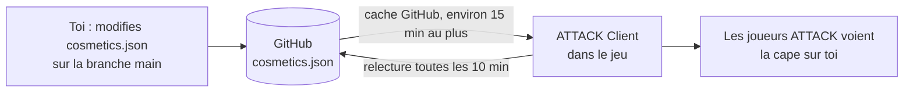

# Capes réservées

[← Sommaire](Home.md)

Le mod ATTACK Client (2.2.0 et plus) lit [`cosmetics/cosmetics.json`](../../cosmetics/cosmetics.json) sur la branche `main`
de ce dépôt pour savoir qui peut porter les capes réservées (aujourd'hui : N2T-48). Les joueurs ATTACK voient alors ces
capes sur eux. **Ce n'est pas le launcher qui lit ce fichier** : le launcher ne fait que l'héberger dans son dépôt.



## Format

```json
{
  "schema": 1,
  "admins": [ { "name": "Pseudo", "uuid": "00000000-0000-4000-8000-000000000001" } ],
  "capes": { "n2t48": [ { "name": "Ami", "uuid": "00000000-0000-4000-8000-000000000002" } ] }
}
```

- `admins` : ont **toutes** les capes réservées. `capes.n2t48` : les autres joueurs qui ont N2T-48.
- Seul l'`uuid` compte, car un pseudo peut changer. Pour trouver l'UUID d'un pseudo, ouvre
  `https://api.mojang.com/users/profiles/minecraft/<pseudo>` (champ `id`).
- Retirer quelqu'un : supprime sa ligne.
- Une modification met jusqu'à environ 15 minutes à arriver en jeu (cache de GitHub, puis relecture toutes les
  10 minutes).
- Un JSON invalide est ignoré : les joueurs gardent la dernière liste valide.

Les UUID et pseudos de ce fichier sont des informations publiques (le dépôt l'est). Ne mets que des joueurs qui ont
donné leur accord.

Voir aussi : [Publier une version](Publier-une-version.md), [Vie privée et sécurité](Vie-privee-et-securite.md).
