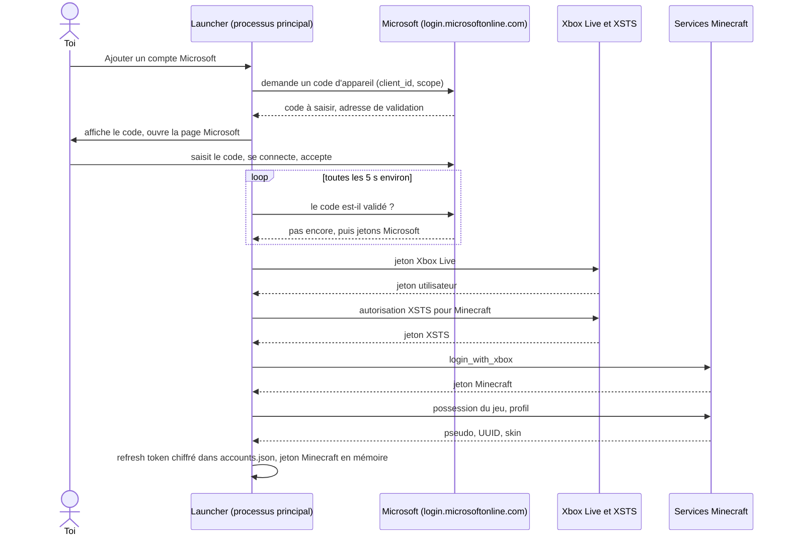
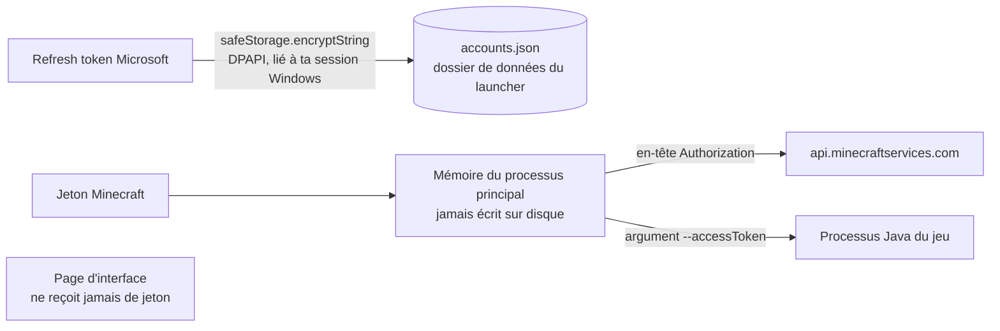
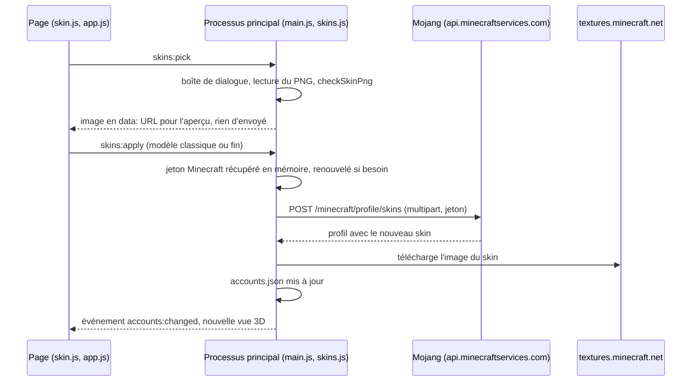

# Comptes et skin

[← Sommaire](Home.md)

## Connexion Microsoft par code d'appareil

Page **Compte** → **Ajouter un compte Microsoft**. Le launcher affiche un **code** et ouvre la page Microsoft
(`microsoft.com/link`) : tu y saisis le code puis tu te connectes. **Le launcher ne voit jamais ton mot de passe** : la
connexion se fait sur le site de Microsoft (connexion par « code d'appareil »).

Détail des étapes (`src/main/auth.js`) :

1. **Code d'appareil** (`startDeviceCode`, `auth.js:93`) : requête vers
   `login.microsoftonline.com/consumers/oauth2/v2.0/devicecode` avec l'ID client Azure et le scope
   `XboxLive.signin offline_access`. Toutes les requêtes OAuth passent par le tenant `consumers`, jamais par `common`
   ni par l'ID de l'annuaire (un test le vérifie).
2. **Attente** (`pollDeviceCode`, `auth.js:116`) : le launcher interroge Microsoft à l'intervalle indiqué
   (au moins 1 s ; +5 s si Microsoft répond `slow_down`) jusqu'à la validation, au refus, à l'annulation ou à
   l'expiration du code. Seule la page de validation renvoyée par Microsoft est ouverte automatiquement, et seulement
   si c'est une adresse `https` d'un domaine Microsoft (`main.js:373-380`). Le code peut aussi être copié ou la page
   rouverte depuis l'interface.
3. **Xbox Live puis XSTS** (`xboxChain`, `auth.js:151`) : deux requêtes vers `user.auth.xboxlive.com` et
   `xsts.auth.xboxlive.com`.
4. **Jeton Minecraft** (`minecraftLogin`, `auth.js:178`) : `login_with_xbox` sur `api.minecraftservices.com`.
5. **Possession du jeu et profil** (`minecraftProfile`, `auth.js:191`) : le launcher vérifie que le compte possède
   Minecraft Java (achat ou Game Pass : si la liste d'achats est vide mais que le profil existe, le profil fait foi),
   puis lit pseudo, UUID et skin.

Tu peux ajouter **plusieurs comptes**, choisir le compte actif et te déconnecter. Les erreurs courantes (pas de profil
Xbox, compte enfant, jeu non possédé, code expiré, application Azure non validée) sont expliquées dans
[Dépannage](Depannage.md).

### L'ID client Azure

Mojang exige que chaque launcher utilise sa propre application Azure. Les joueurs n'ont **rien à configurer** : par
défaut, le launcher utilise l'application officielle d'ATTACK Launcher (`DEFAULT_MS_CLIENT_ID`,
`src/main/settings.js:18`). L'ordre de priorité est : Réglages → ID client Azure, puis la variable d'environnement
`ATTACK_MS_CLIENT_ID`, puis l'application officielle. Un ID client **n'est pas un secret** : il identifie l'application
auprès de Microsoft, comme dans tous les launchers open source. Procédure pour en créer un :
[Publier une version](Publier-une-version.md#créer-lapp-azure-une-seule-fois-pour-qui-publie-le-launcher).

## Où vivent les jetons

| Donnée | Stockage | Réf. |
| --- | --- | --- |
| Refresh token Microsoft | `accounts.json`, **chiffré** par `safeStorage` (DPAPI sous Windows) puis encodé en base64 | `main.js:50-58`, `accounts.js:73` |
| Jeton Minecraft (`accessToken`) et son expiration | **Mémoire seulement** (`Map` du `AccountStore`), jamais écrits | `accounts.js:27`, `accounts.js:78` |
| Jeton d'accès Microsoft, jetons Xbox et XSTS | Utilisés le temps de la connexion, **non conservés** | `auth.js:211-216` |
| Pseudo, UUID, skin (image en `data:` URL), modèle de bras, date d'ajout | `accounts.json`, en clair (ce ne sont pas des secrets) | `accounts.js:67-75` |

- **Pas de repli en clair** : si le chiffrement Windows n'est pas disponible, la connexion échoue (« Chiffrement Windows
  indisponible : impossible de garder la connexion », `main.js:52`) au lieu d'écrire le jeton en clair.
- **Ce que DPAPI protège** : le fichier ne se relit pas depuis un autre compte Windows ou un autre PC. Comme pour tout
  chiffrement DPAPI, un programme qui tourne sous **ta** session Windows peut en principe le déchiffrer : garde ta
  session propre.
- La **vue publique** des comptes (`list()`, `accounts.js:49`) ne contient jamais de jeton : c'est la seule chose que la page
  voit.
- **Renouvellement** : au démarrage, le compte actif est rafraîchi en silence (`main.js:517-526`). Avant un lancement
  ou un changement de skin, si le jeton Minecraft manque ou expire dans moins de 5 minutes, il est renouvelé
  (`accounts.js:119-130`). Microsoft renvoie un nouveau refresh token, qui remplace l'ancien (chiffré). Si le profil
  Minecraft renvoyé n'est plus celui du compte, le renouvellement est refusé.
- **Déconnecter** supprime l'entrée du compte, donc son refresh token chiffré, de `accounts.json` et le jeton Minecraft
  de la mémoire. Le launcher ne fait pas d'appel de révocation chez Microsoft : tu peux retirer l'autorisation depuis
  ton compte Microsoft si tu le souhaites.
- **Journaux** : aucun jeton n'est journalisé. La ligne de commande du jeu enregistrée dans
  `game-*.log` masque la valeur qui suit `--accessToken` et `--session`, et toute occurrence du jeton ailleurs
  (`game.js:132-139`). Le jeton est pourtant bien passé au jeu en argument (c'est ainsi que Minecraft 1.8.9 le reçoit) : il
  reste donc visible dans la liste des processus de ta session Windows pendant la partie.

## Skin 3D et changement de skin

Page **Compte** → carte **Skin** : le skin du compte actif en 3D (il tourne tout seul ; glisse pour le tourner, choisis
Marche, Course ou Repos). La vue utilise [skinview3d](https://github.com/bs-community/skinview3d) 3.4.2 (licence MIT,
avec three.js), copiée dans `src/renderer/vendor/` : la page ne télécharge rien.

- **Changer de skin…** : tu choisis un PNG de 64 x 64 pixels (ou 64 x 32, ancien format), puis le **modèle des bras**
  (Classique / Steve, ou Fin / Alex). L'aperçu s'affiche **avant** tout envoi ; **Appliquer ce skin** l'envoie à Mojang.
- **Skin par défaut** remet Steve ou Alex ; **Actualiser** relit le skin si tu l'as changé ailleurs (minecraft.net).
- C'est le skin de ton **compte Minecraft** : il change partout (serveurs, autres launchers), comme sur minecraft.net.

- **Le jeton ne passe jamais par la page** : seul le processus principal parle à `api.minecraftservices.com` avec le
  jeton Minecraft ; la page ne reçoit que des images en `data:` URL (la CSP lui interdit toute image externe)
  (`skins.js:1-4`, `main.js:245-310`).
- **Fichier vérifié avant l'envoi** (`checkSkinPng`, `skins.js:22-35`) : signature PNG, 24 Ko au plus, en-tête `IHDR`,
  64 x 64 ou 64 x 32. Le modèle doit être `classic` ou `slim`.
- **Rien n'est envoyé avant le clic sur Appliquer** : le PNG choisi reste en mémoire dans le processus principal
  (`pendingSkin`) jusqu'à l'envoi ou l'abandon (`skins:discard`).
- **Routes Mojang utilisées** : `POST /minecraft/profile/skins` (envoi), `DELETE /minecraft/profile/skins/active` (skin par
  défaut), `GET /minecraft/profile` (actualiser). Les erreurs sont traduites : 401 session expirée, 429 trop de changements,
  400 skin refusé (`skins.js:45-54`).
- Le skin est enregistré dans `accounts.json` sous forme d'image (`data:` URL) pour s'afficher sans réseau.

## Compte hors ligne (mode développeur)

Voir [Fonctionnalités](Fonctionnalites.md#mode-développeur) : pseudo seul, jeton « 0 », refusé par les serveurs en ligne.

Voir aussi : [Vie privée et sécurité](Vie-privee-et-securite.md), [Architecture](Architecture.md).
