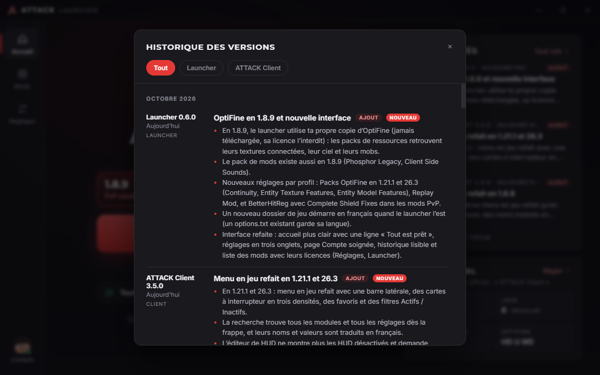
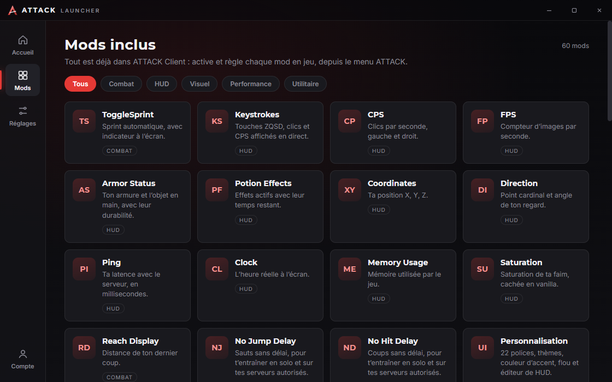
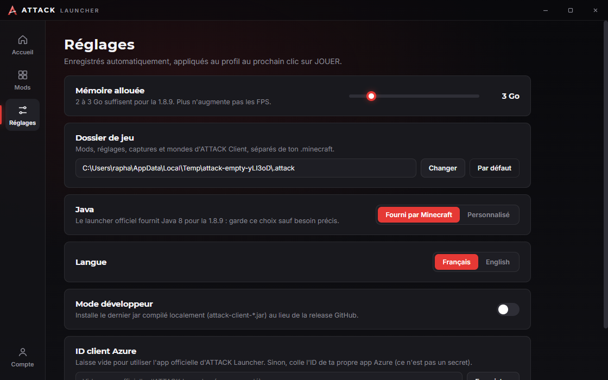

# Fonctionnalités

[← Sommaire](Home.md)

Le launcher a quatre pages (barre de gauche) et une bannière de mise à jour. Tout est disponible en français et en
anglais (Réglages → Langue).

## Accueil

- **INSTALLER** (puis **JOUER** une fois tout installé) : installe Minecraft 1.8.9, Forge et ATTACK Client, et crée le
  profil du launcher officiel. Quatre voyants (Minecraft, Forge, ATTACK Client, Profil du launcher) indiquent ce qui
  est présent ; celui du mod affiche sa version.
- **Vérifier / réparer l'installation** : relance l'installation, qui recontrôle chaque fichier et ne retélécharge que
  ce qui manque ou est abîmé (voir [Installation et mises à jour](Installation-et-mises-a-jour.md)).
- **Ouvrir le dossier de jeu** et **Journaux du jeu** (`<dossier de jeu>\logs\launcher`).
- **Nouveautés** : les trois dernières entrées de l'historique ; **Tout voir** ouvre l'historique complet.

## Mods

Vitrine des **60 modules** inclus dans ATTACK Client, filtrables par catégorie (Combat, HUD, Visuel, Performance,
Utilitaire). C'est une liste d'information (`src/renderer/data.js`) : on active et règle chaque module **en jeu**,
depuis le menu ATTACK, pas dans le launcher.

## Réglages

Les réglages sont enregistrés automatiquement dans `%APPDATA%\ATTACK Launcher\settings.json` et appliqués au profil
au prochain clic sur JOUER. Toute valeur passe par `sanitize()` (`src/main/settings.js`) : type, bornes, chemins absolus.

| Réglage | Détail |
| --- | --- |
| Mémoire allouée | 1 Go minimum, par pas de 256 Mo, 2 Go par défaut. Le curseur monte jusqu'à la mémoire de ce PC (entre 4 et 16 Go). Un avertissement apparaît au-delà de la moitié de la mémoire du PC. Valeur transmise au jeu en `-Xmx`. |
| Dossier de jeu | `%APPDATA%\.attack` par défaut : mods, réglages, captures et mondes d'ATTACK Client, séparés de ton `.minecraft`. |
| Java | « Fourni par Minecraft » (runtime `jre-legacy`, Java 8, installé par le launcher) ou « Personnalisé » (chemin d'un `javaw.exe` ou `java.exe`). |
| Langue | Français ou English. |
| Mode développeur | Voir plus bas. |
| ID client Azure | Identifiant de l'application Azure utilisée pour la connexion Microsoft. Vide : l'application officielle d'ATTACK Launcher est utilisée. Ce n'est pas un secret. Voir [Publier une version](Publier-une-version.md). |

Le pied de page indique la version du launcher et le dossier `.minecraft` utilisé.

## Compte

Ajout de comptes Microsoft (plusieurs possibles), choix du compte actif, déconnexion, et carte **Skin** (vue 3D,
changement de skin). Tout est détaillé dans [Comptes et skin](Comptes-et-skin.md).

## Bannière de mise à jour

Quand une nouvelle version du launcher est prête, une bannière apparaît en haut de la fenêtre :
« Mise à jour X.Y.Z prête » avec **Redémarrer** (version installée), ou « Nouvelle version disponible » avec un
bouton vers la page Releases (version portable). Voir [Installation et mises à jour](Installation-et-mises-a-jour.md).

## Deux façons de jouer

| | Avec un compte connecté | Sans compte |
| --- | --- | --- |
| Ce que fait JOUER | Lance directement le jeu | Ouvre le launcher Minecraft officiel sur le profil « ATTACK Client » |
| Java | Celui des Réglages, sinon le runtime officiel de Mojang (installé par le launcher) | Celui du launcher officiel (ou celui du profil, si tu en as choisi un dans Réglages) |
| Connexion au jeu | Jeton Minecraft fourni par le launcher | Connexion gérée par le launcher officiel |
| Journal | `<dossier de jeu>\logs\launcher\game-*.log` | Celui du launcher officiel |

Le lancement direct : natives extraites dans `<.minecraft>\versions\<version Forge>\natives-attack`, classpath Forge +
Minecraft 1.8.9, mémoire des Réglages, arguments Java par défaut du launcher officiel (G1GC...), configuration log4j de
Mojang (qui corrige aussi la faille Log4Shell des anciennes versions). Marque envoyée au jeu :
`-Dminecraft.launcher.brand=attack-launcher` (`src/main/game.js:97-130`).

Sans compte, le launcher met le profil « ATTACK Client » en dernier utilisé (`markLastUsed`) : avec le tri « par dernière
partie » du launcher officiel, il est présélectionné.

## Profil du launcher officiel

À l'installation (et à chaque clic sur JOUER sans compte), le launcher fusionne un profil **« ATTACK Client »** dans
`%APPDATA%\.minecraft\launcher_profiles.json` (`src/main/profiles.js`) :

- version : Forge 1.8.9 (`1.8.9-forge1.8.9-11.15.1.2318-1.8.9`), dossier de jeu séparé, `-Xmx` tiré des Réglages, autres
  arguments Java conservés (ceux du launcher officiel par défaut), Java personnalisé si choisi, icône ATTACK ;
- **fusion, pas remplacement** : tes autres profils et réglages restent intacts, la date de création du profil est gardée ;
- une copie `launcher_profiles.json.bak` est faite avant **chaque** écriture, et l'écriture est atomique (fichier
  temporaire puis renommage) ;
- si le fichier est illisible (JSON cassé), il n'est **jamais** écrasé : le launcher le signale et n'y touche pas.

Ferme le launcher officiel pendant l'installation : il peut réécrire ce fichier.

## Mode développeur

Réglages → **Mode développeur**. À utiliser tant qu'aucune release du mod n'est publiée, ou pour tester un jar compilé
à la main :

- l'installation copie le **dernier** `attack-client-*.jar` du dossier indiqué (par défaut
  `Documents\pvp-essentials\build\libs`, ou la variable d'environnement `ATTACK_DEV_JAR_DIR`) au lieu de télécharger
  la release GitHub ; les jars `-sources`, `-javadoc`, `-dev`, `-deobf` sont ignorés ;
- l'état d'installation marque alors la source « dev » ;
- il devient possible d'ajouter un **compte hors ligne** (pseudo de 3 à 16 caractères, lettres, chiffres, `_`) : UUID calculé
  comme Minecraft (« OfflinePlayer »), jeton « 0 ». Utile pour tester le lancement direct en solo sans compte Microsoft ;
  **les serveurs en ligne refusent ces comptes**. Le canal `accounts:addOffline` refuse la demande si le mode n'est pas actif.

## Modes de mise à jour selon la version

| Version | Mise à jour |
| --- | --- |
| Installée (`Setup.exe`) | Téléchargement en arrière-plan, installation au redémarrage |
| Portable | Simple avis avec lien vers la page Releases |
| Lancée depuis les sources (`npm start`) | Désactivée |

Voir aussi : [Architecture](Architecture.md), [Dépannage](Depannage.md).
