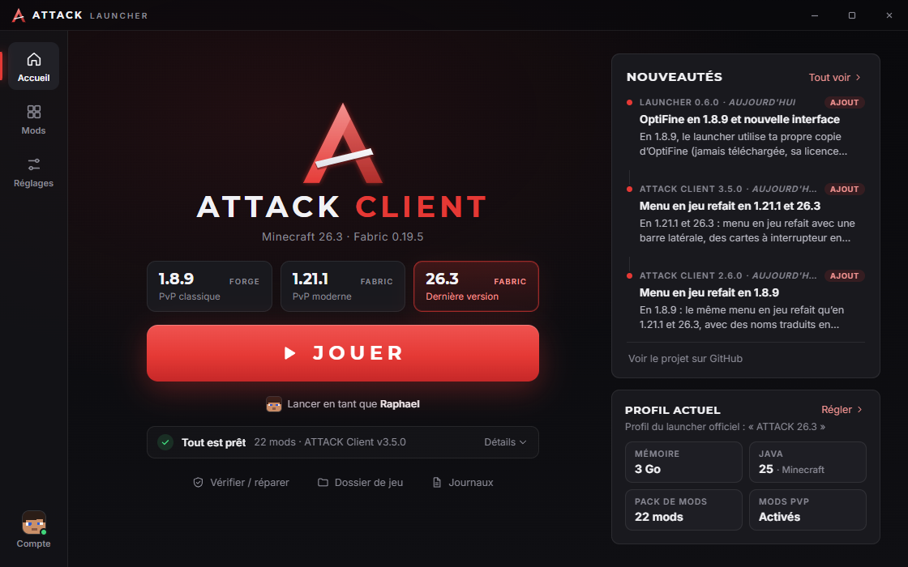
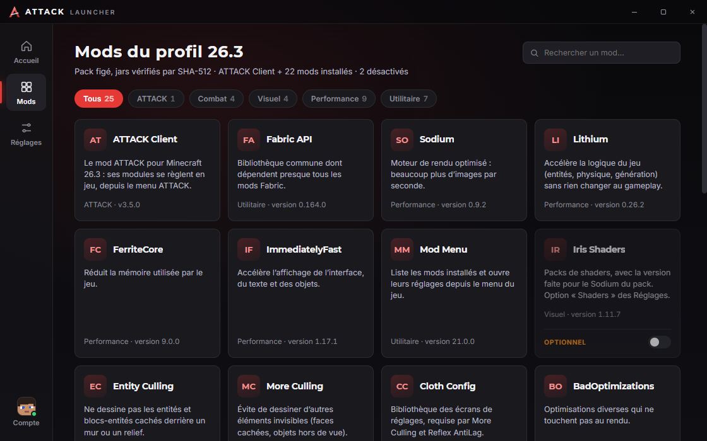

# Fonctionnalités

[← Sommaire](Home.md)

Le launcher a quatre pages (barre de gauche) et une bannière de mise à jour. Tout est disponible en français et en
anglais (Réglages → Langue).

## Accueil

- **Choix du profil** : trois cartes au-dessus de JOUER, **1.8.9** (Forge, « PvP classique »), **1.21.1** (« PvP moderne ») et
  **26.3** (Fabric, « Dernière version »). Chaque profil est indépendant : son dossier de jeu, son état d'installation, son
  profil dans le launcher officiel, son Java (8, 21 ou 25) et ses réglages. Le choix est retenu d'un lancement à l'autre ; il
  est bloqué pendant une installation ou un lancement.
- **INSTALLER** (puis **JOUER** une fois tout installé) : installe Minecraft, le chargeur de mods (Forge ou Fabric Loader),
  le pack de mods du profil, la copie d'OptiFine du joueur (1.8.9), le mod ATTACK, et crée le profil du launcher officiel.
  Pendant l'installation, la progression est **dans le bouton** (« INSTALLATION 42 % »).
- **Sous le bouton** : « Lancer en tant que *pseudo* » avec la tête du joueur quand un compte est connecté, sinon
  l'explication (« Ouvre le launcher officiel sur le profil … » et un lien **Connecter un compte**).
- **Ligne « Tout est prêt · N mods · ATTACK Client vX »** : un résumé à la place des anciennes tuiles ; **Détails** ouvre la
  liste (Minecraft, chargeur, pack de mods, OptiFine en 1.8.9, ATTACK Client avec sa version, profil du launcher) avec ce qui
  reste à installer. Quand il n'y a rien à installer mais un retrait à faire (réglage OptiFine coupé alors que la copie est encore
  dans `mods`), la ligne dit « Mise à jour à appliquer » et la ligne OptiFine du détail « à retirer ». Si la copie d'origine a
  disparu mais que le jar copié est toujours dans `mods`, la ligne OptiFine dit « déjà copié dans mods » et il est compté. Le nombre de mods est le
  même que sur la page Mods et dans la carte **Profil actuel**.
- **Rail de droite** : les trois dernières **Nouveautés** et la carte **Profil actuel** (mémoire, Java, pack de mods, mods PvP
  ou OptiFine) avec un lien **Régler**.
- **Vérifier / réparer l'installation** : relance l'installation, qui recontrôle chaque fichier et ne retélécharge que
  ce qui manque ou est abîmé (voir [Installation et mises à jour](Installation-et-mises-a-jour.md)).
- **Ouvrir le dossier de jeu** et **Journaux du jeu** (`<dossier de jeu>\logs\launcher`).
- **Nouveautés** : les trois dernières entrées de l'historique (version, date, étiquette Perf / Ajout / Correctif / Amélioration,
  titre court) ; **Tout voir** ouvre l'historique complet, regroupé **par mois**, filtrable (Tout, Launcher, ATTACK Client).

## Mods

Elle suit le profil choisi sur l'accueil :

- **1.8.9** : le mod ATTACK, **OptiFine** (ta copie, avec son interrupteur), les mods du pack Forge (Phosphor Legacy, Client
  Side Sounds, Replay Mod en option) et la vitrine des **62 modules** d'ATTACK Client, filtrables par catégorie (Combat, HUD,
  Visuel, Performance, Utilitaire). Les modules sont une liste d'information (`src/renderer/data.js`) : on les active et on
  les règle **en jeu**, depuis le menu ATTACK, pas dans le launcher.
- **1.21.1 et 26.3** : le mod ATTACK (avec sa version installée, ou « à installer ») et les mods du **pack figé** avec leur
  version (Fabric API, Sodium, Lithium, FerriteCore, ImmediatelyFast, Entity Culling, More Culling, BadOptimizations,
  ModernFix en 1.21.1, Krypton, Reflex AntiLag, Mod Menu, Continuity, Entity Texture / Model Features, Iris et Replay Mod en
  option, et les mods PvP : Crystal Optimizer, Anchor Optimizer, BetterHitReg, Complete Shield Fixes). Pas d'icônes venant de
  Modrinth : la page n'a le droit de charger aucune image distante.
- **Recherche** (« Rechercher un mod… »), **compteurs** par catégorie, et sur chaque mod d'un groupe réglable (Iris, mods PvP,
  packs OptiFine, Replay Mod) un **interrupteur** lié au réglage du même nom ; la carte est estompée quand le groupe est
  coupé. L'en-tête compte les mods **installés** (le même nombre que sur l'accueil) et ceux qui sont désactivés. Quand
  un réglage a changé, un bandeau « Le pack de mods a changé » propose **Installer maintenant**.

## Réglages

Les réglages sont répartis en **trois onglets** : **Ce profil** (mémoire avec sa zone recommandée et des raccourcis 2, 3, 4, 6 Go,
dossier de jeu, Java, pack de mods avec ses interrupteurs, carte OptiFine en 1.8.9), **Launcher** (langue, À propos, mods et
licences) et **Avancé** (arguments Java, mode développeur, ID client Azure). Un bandeau « À appliquer » avec **Installer maintenant**
apparaît quand un réglage du pack attend une installation, et chaque interrupteur affiche **Appliqué**, **À appliquer** ou **Désactivé**.

Les réglages sont enregistrés automatiquement dans `%APPDATA%\ATTACK Launcher\settings.json` et appliqués au profil
au prochain clic sur JOUER. Toute valeur passe par `sanitize()` (`src/main/settings.js`) : type, bornes, chemins absolus.
Certains réglages sont **globaux** (mémoire, langue, mode développeur, ID client Azure, profil choisi), d'autres **propres à
chaque profil** (mémoire du jeu, dossier de jeu, Java, arguments Java, dossier des jars de développement, groupes de mods du pack, OptiFine) :
l'onglet **Ce profil** porte un badge qui rappelle le profil concerné. Un ancien `settings.json` (réglages tous globaux) est migré tout seul : son dossier de jeu, son Java
et son dossier de jars deviennent ceux du profil 1.8.9.

| Réglage | Détail |
| --- | --- |
| Mémoire allouée | 1 Go minimum, par pas de 256 Mo, 2 Go par défaut. Le curseur monte jusqu'à la mémoire de ce PC (entre 4 et 16 Go). Un avertissement apparaît au-delà de la moitié de la mémoire du PC. Valeur transmise au jeu en `-Xmx`. |
| Dossier de jeu | Par profil : `%APPDATA%\.attack` (1.8.9) ou `%APPDATA%\.attack\profiles\fabric-<version>` (Fabric) par défaut : mods, réglages, captures et mondes d'ATTACK Client, séparés de ton `.minecraft`. Deux profils ne peuvent pas partager le même dossier : le launcher garde l'ancien (et l'installation refuse un dossier déjà marqué par un autre profil). |
| Java | Par profil : « Fourni par Minecraft » (runtime officiel du profil : Java 8, 21 ou 25, installé par le launcher) ou « Personnalisé » (chemin d'un `javaw.exe` ou `java.exe`). |
| Arguments Java | Par profil, vide par défaut. Options ajoutées **après** les arguments par défaut (G1GC...) : pour la JVM, la dernière valeur d'une option l'emporte, donc tu peux aussi en remplacer une (`-XX:MaxGCPauseMillis=30`). Exception : un seul ramasse-miettes à la fois ; si tu en choisis un autre (`-XX:+UseZGC`, `-XX:+UseParallelGC`...), les options G1 par défaut sont retirées. Séparées par des espaces, 1000 caractères et 40 options au plus. **Liste d'autorisation** (`src/main/jvmargs.js`) : `-Xms`, `-Xss`, `-Xmn` ; `-XX:+Nom`, `-XX:-Nom`, `-XX:Nom=valeur` (valeur simple, sans chemin), sauf les options qui lancent une commande, lisent ou écrivent un fichier (`OnError`, `VMOptionsFile`, `ErrorFile`, `HeapDump...`, `StartFlightRecording`...) ou règlent la mémoire maximale (`-Xmx`, `MaxRAM`, `MaxHeapSize` : c'est le curseur Mémoire) ; et les propriétés `sun.java2d.*`, `file.encoding`, `sun.jnu.encoding`, `user.language`, `user.country`, `java.net.preferIPv4Stack`. Tout le reste est refusé, parce que beaucoup d'options chargent du code (`-javaagent`, `-Xbootclasspath`, `-Dfabric.addMods`) ou détournent la connexion (`-Dminecraft.api.session.host` enverrait ton jeton ailleurs). Un argument refusé est expliqué sous le champ, l'ancienne valeur est gardée. Une option que ta version de Java ne connaît pas empêche le jeu de démarrer : lis alors `game-*.log`. |
| Shaders (Iris) | Profils Fabric seulement : ajoute Iris au pack de mods (version qui va avec Sodium). Appliqué à la prochaine installation (bouton INSTALLER) ; coupé, Iris est retiré à l'installation suivante. |
| Mods PvP (latence) | Profils Fabric, activé par défaut : Crystal Optimizer, Anchor Optimizer, WalksyLib, BetterHitReg et Complete Shield Fixes. À couper si un serveur les interdit. |
| Packs OptiFine | Profils Fabric, activé par défaut : Continuity, Entity Texture Features et Entity Model Features lisent les packs de ressources au format OptiFine sans OptiFine. |
| Replay Mod | Les trois profils, **coupé par défaut** : enregistre les parties pour les revoir et les monter. |
| OptiFine | Profil 1.8.9, activé par défaut : copie **ta** copie d'OptiFine (trouvée dans `.minecraft\libraries\optifine`, `.minecraft\mods` ou choisie avec **Choisir le fichier…**) dans le dossier mods du profil. Le launcher ne le télécharge jamais : sans copie, un texte explique et **optifine.net** s'ouvre dans le navigateur. Voir [OptiFine pour la 1.8.9](Installation-et-mises-a-jour.md#optifine-pour-la-189-la-copie-du-joueur). |
| Langue | Français ou English. Elle sert aussi de langue de départ à Minecraft : écrite dans `options.txt` à la création du fichier seulement, un `options.txt` existant garde sa langue (voir [Le pack de mods](Installation-et-mises-a-jour.md#le-pack-de-mods-les-trois-profils)). |
| À propos | Version du launcher, dossier `.minecraft`, et **Mods et licences** : tous les mods du pack du profil avec auteur, version et licence, et la phrase de crédit. |
| Mode développeur | Voir plus bas. |
| ID client Azure | Identifiant de l'application Azure utilisée pour la connexion Microsoft. Vide : l'application officielle d'ATTACK Launcher est utilisée. Ce n'est pas un secret. Voir [Publier une version](Publier-une-version.md). |

Le pied de page indique la version du launcher et le dossier `.minecraft` utilisé.

## Compte

Ajout de comptes Microsoft (plusieurs possibles), choix du compte actif, déconnexion, et carte **Skin** (vue 3D,
changement de skin). Tout est détaillé dans [Comptes et skin](Comptes-et-skin.md).

## Bannière de mise à jour

Quand une nouvelle version du launcher est prête, une bannière apparaît en haut de la fenêtre :
« Mise à jour X.Y.Z prête » avec **Redémarrer** (version installée), ou « Nouvelle version disponible » avec un
bouton vers la page Releases (version portable). Voir [Installation et mises à jour](Installation-et-mises-a-jour.md).

## Deux façons de jouer

| | Avec un compte connecté | Sans compte |
| --- | --- | --- |
| Ce que fait JOUER | Lance directement le jeu | Ouvre le launcher Minecraft officiel sur le profil du même nom que celui choisi (« ATTACK Client », « ATTACK 1.21.1 » ou « ATTACK 26.3 ») |
| Java | Celui des Réglages, sinon le runtime officiel de Mojang (installé par le launcher) | Celui du launcher officiel (ou celui du profil, si tu en as choisi un dans Réglages) |
| Connexion au jeu | Jeton Minecraft fourni par le launcher | Connexion gérée par le launcher officiel |
| Journal | `<dossier de jeu>\logs\launcher\game-*.log` | Celui du launcher officiel |

Le lancement direct : natives extraites dans `<.minecraft>\versions\<version du profil>\natives-attack`, classpath du
chargeur + Minecraft, mémoire des Réglages, arguments Java par défaut du launcher officiel (G1GC...) puis ceux des Réglages, configuration log4j de
Mojang (qui corrige aussi la faille Log4Shell des anciennes versions). Marque envoyée au jeu :
`-Dminecraft.launcher.brand=attack-launcher` (`src/main/game.js:97-130`).

Sans compte, le launcher met le profil ATTACK choisi (« ATTACK Client », « ATTACK 1.21.1 » ou « ATTACK 26.3 ») en dernier utilisé (`markLastUsed`) : avec le tri « par dernière
partie » du launcher officiel, il est présélectionné.

## Profil du launcher officiel

À l'installation (et à chaque clic sur JOUER sans compte), le launcher fusionne le profil du profil choisi dans
`%APPDATA%\.minecraft\launcher_profiles.json` (`src/main/profiles.js`) : **« ATTACK Client »** (identifiant
`attack-client`, inchangé), **« ATTACK 1.21.1 »** (`attack-fabric-1.21.1`) ou **« ATTACK 26.3 »** (`attack-fabric-26.3`) :

- version : Forge 1.8.9 (`1.8.9-forge1.8.9-11.15.1.2318-1.8.9`) ou Fabric Loader (`fabric-loader-0.19.5-1.21.1`,
  `fabric-loader-0.19.5-26.3`), dossier de jeu séparé, `-Xmx` tiré des Réglages, Java personnalisé si choisi,
  icône ATTACK ;
- arguments Java : si tu en as mis dans Réglages, ceux par défaut suivis des tiens ; sinon, ceux déjà dans le profil
  sont conservés (tu as pu les modifier dans le launcher officiel) et seul `-Xmx` change. Quand tu vides le champ,
  les arguments qu'ATTACK avait écrits (défauts + options autorisées) sont retirés : le profil revient aux défauts ;
- **fusion, pas remplacement** : tes autres profils et réglages restent intacts, la date de création du profil est gardée ;
- une copie `launcher_profiles.json.bak` est faite avant **chaque** écriture, et l'écriture est atomique (fichier
  temporaire puis renommage) ;
- si le fichier est illisible (JSON cassé), il n'est **jamais** écrasé : le launcher le signale et n'y touche pas.

Ferme le launcher officiel pendant l'installation : il peut réécrire ce fichier.

## Mode développeur

Réglages → **Mode développeur**. À utiliser tant qu'aucune release du mod n'est publiée, ou pour tester un jar compilé
à la main :

- l'installation copie le **dernier** jar du profil (`attack-client-*.jar` en 1.8.9, `attack-fabric-<version>+mc<mc>.jar`
  en Fabric) du dossier indiqué (par défaut `Documents\pvp-essentials\build\libs` en 1.8.9,
  `Documents\attack-client-fabric\versions\<mc>\build\libs` en Fabric, ou les variables d'environnement
  `ATTACK_DEV_JAR_DIR` et `ATTACK_DEV_JAR_DIR_FABRIC_1_21_1` / `_26_3`) au lieu de télécharger la release GitHub ; les jars
  `-sources`, `-javadoc`, `-dev`, `-deobf` sont ignorés ;
- l'état d'installation marque alors la source « dev » ;
- il devient possible d'ajouter un **compte hors ligne** (pseudo de 3 à 16 caractères, lettres, chiffres, `_`) : UUID calculé
  comme Minecraft (« OfflinePlayer »), jeton « 0 ». Utile pour tester le lancement direct en solo sans compte Microsoft ;
  **les serveurs en ligne refusent ces comptes**. Le canal `accounts:addOffline` refuse la demande si le mode n'est pas actif.

## Modes de mise à jour selon la version

| Version | Mise à jour |
| --- | --- |
| Installée (`Setup.exe`) | Téléchargement en arrière-plan, installation au redémarrage |
| Portable | Simple avis avec lien vers la page Releases |
| Lancée depuis les sources (`npm start`) | Désactivée |

Voir aussi : [Architecture](Architecture.md), [Dépannage](Depannage.md).
