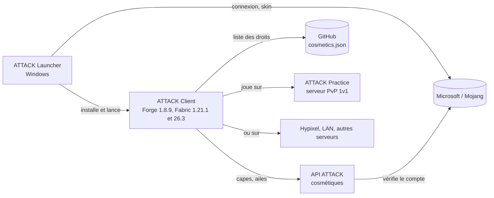
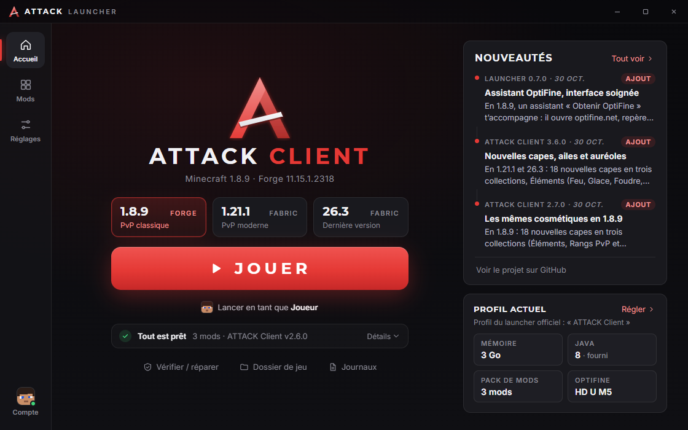
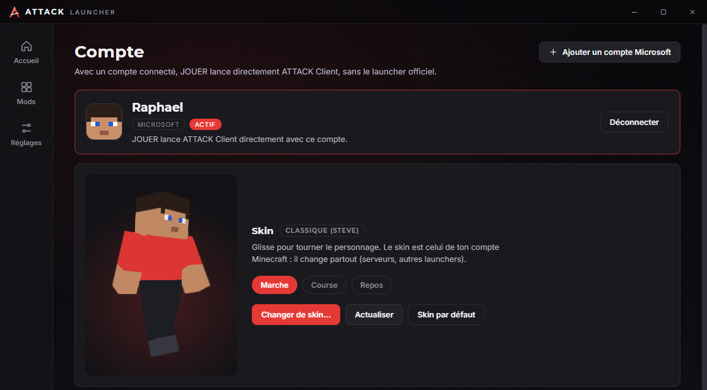

# Wiki d'ATTACK Launcher

[← Retour au README](../../README.md)

ATTACK Launcher est le launcher Windows (Electron) d'**ATTACK Client**, le client de PvP pour Minecraft. Il propose
trois profils : **1.8.9** (Forge), **1.21.1** et **26.3** (Fabric, avec un pack de mods de performance figé). Il installe
Minecraft, le chargeur et le mod, gère la connexion Microsoft, lance le jeu directement, affiche ton skin en 3D et se met
à jour tout seul. Les releases (jar du mod compris) sont publiées sur
[7ShIkI3/attack-launcher](https://github.com/7ShIkI3/attack-launcher/releases).

## Sommaire

| Page | Tu y trouves |
| --- | --- |
| [Architecture](Architecture.md) | Processus principal, page d'interface, IPC, schémas, rôle de chaque fichier de `src/` |
| [Fonctionnalités](Fonctionnalites.md) | Accueil et profils, Mods, Réglages, Compte ; lancement direct ou par le launcher officiel ; mode développeur ; profils officiels |
| [Installation et mises à jour](Installation-et-mises-a-jour.md) | Les trois profils, ce qui est installé et où, pack de mods, vérification des hash, sources autorisées, mises à jour automatiques |
| [Comptes et skin](Comptes-et-skin.md) | Connexion Microsoft par code d'appareil, stockage des jetons, skin 3D et changement de skin |
| [Vie privée et sécurité](Vie-privee-et-securite.md) | Données, destinataires, durées, protections, avec références `fichier:ligne` |
| [Développement](Developpement.md) | Commandes npm, tests unitaires et tests réels, captures d'écran |
| [Publier une version](Publier-une-version.md) | Release du launcher et des jars du mod (Forge et Fabric), mise à jour des packs de mods, application Azure |
| [Capes réservées](Capes-reservees.md) | Donner une cape réservée avec `cosmetics/cosmetics.json` |
| [Dépannage](Depannage.md) | SmartScreen, erreurs de connexion, d'installation, de mise à jour |

## Vue d'ensemble de l'écosystème ATTACK

| Dépôt | Rôle |
| --- | --- |
| `7ShIkI3/attack-launcher` | Ce launcher. Les releases (launcher et jar du mod) sont publiées ici. |
| `7ShIkI3/attack-client` | Le mod Forge « ATTACK Client » (62 modules, interface, cosmétiques, amis et chat). |
| `attack-client-fabric` | Le mod Fabric ATTACK pour 1.21.1 et 26.3 (un jar `attack-fabric-<version>+mc<mc>.jar` par version de Minecraft). |
| `7ShIkI3/attack-server` | L'API Node des cosmétiques partagés (capes, ailes). |
| ATTACK Practice | Plugin PandaSpigot 1.8.8 : serveur PvP 1v1 (pas encore sur GitHub). |

Ce wiki ne décrit que le launcher. Le launcher ne contacte ni l'API ATTACK ni le serveur Practice : seules les
adresses listées dans [Vie privée et sécurité](Vie-privee-et-securite.md) sont autorisées.

## Captures

| Accueil | Compte et skin 3D |
| --- | --- |
|  |  |

Les captures montrent un compte factice (« Raphou ») avec un skin de test.
