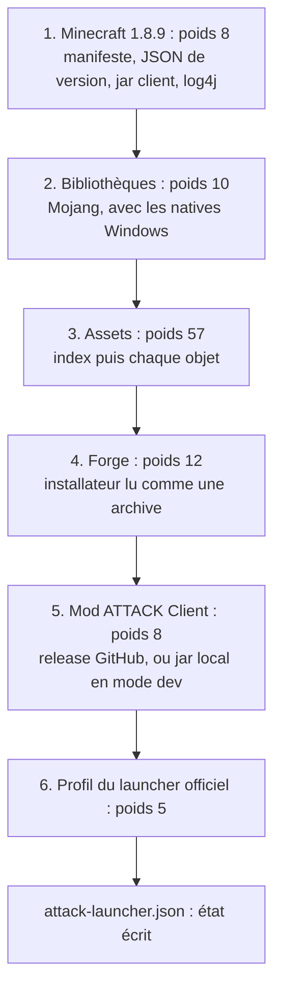
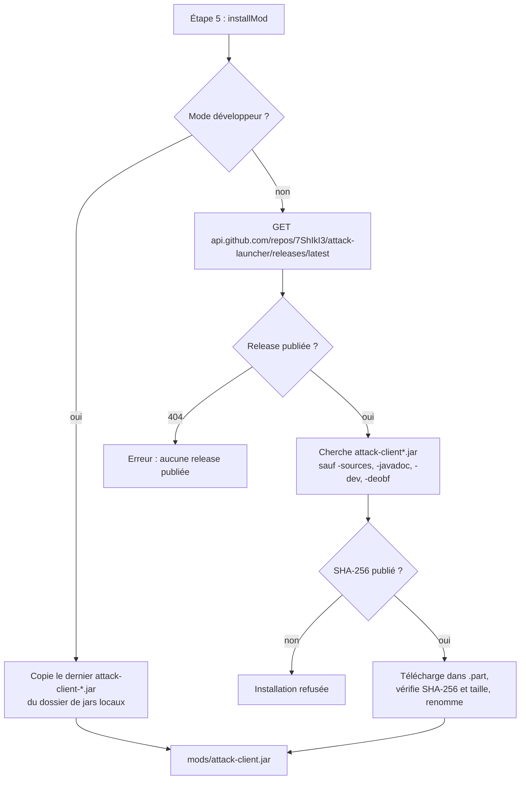
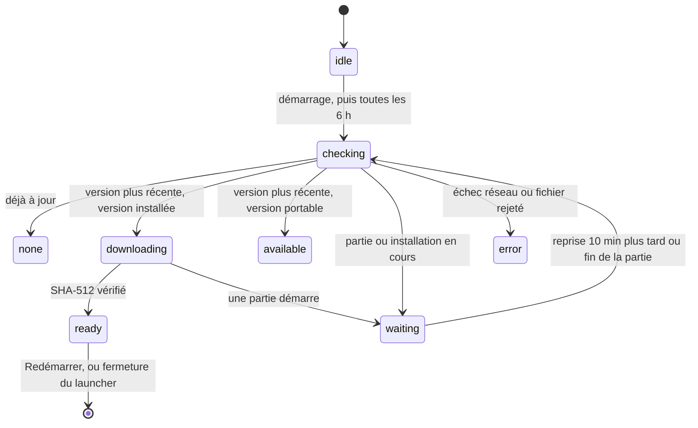

# Installation et mises à jour

[← Sommaire](Home.md)

## Ce qui est installé, et où

| Élément | Emplacement |
| --- | --- |
| Minecraft 1.8.9 (JSON, jar, bibliothèques, ressources) | `%APPDATA%\.minecraft\versions\1.8.9`, `libraries`, `assets` |
| Forge 1.8.9-11.15.1.2318 | `%APPDATA%\.minecraft\versions\1.8.9-forge1.8.9-11.15.1.2318-1.8.9` |
| Dossier de jeu séparé (mods, réglages, captures, mondes) | `%APPDATA%\.attack` (modifiable dans Réglages) |
| Mod ATTACK Client | `%APPDATA%\.attack\mods\attack-client.jar` |
| État de l'installation (versions, source du mod, SHA-256, date) | `%APPDATA%\.attack\attack-launcher.json` |
| Profil « ATTACK Client » | fusionné dans `%APPDATA%\.minecraft\launcher_profiles.json` (copie `.bak` avant chaque écriture) |
| Java 8 officiel de Mojang (lancement direct) | `%LOCALAPPDATA%\ATTACK Launcher\runtime` |
| Natives du jeu (extraites au lancement) | `%APPDATA%\.minecraft\versions\<version Forge>\natives-attack` |
| Réglages, comptes, journal des mises à jour | `%APPDATA%\ATTACK Launcher\` (`settings.json`, `accounts.json`, `logs\updater.log`) |
| Mise à jour téléchargée, en attente | `%LOCALAPPDATA%\attack-launcher-updater` (dossier de cache d'`electron-updater`) |

Le **dossier de jeu séparé** évite tout mélange avec les autres mods de ton `.minecraft`. Ferme le launcher officiel
pendant l'installation : il peut réécrire `launcher_profiles.json`.

## Déroulé d'une installation

Le bouton **INSTALLER** (et **Vérifier / réparer l'installation**) lance `installer.install()`. La barre de progression
est pondérée par étape (`STEPS`, `installer.js:16-23`).

1. **Minecraft** : le manifeste des versions (`piston-meta.mojang.com`) donne l'adresse et le SHA-1 du JSON de la
   1.8.9 ; ce JSON est vérifié, puis le jar client (SHA-1 et taille) et la configuration log4j.
2. **Bibliothèques** : chaque fichier a son SHA-1 dans le JSON ; le chemin annoncé doit être celui que calcule le
   launcher à partir du nom Maven (sinon : « Chemin inattendu », `mojang.js:56-61`). Les natives Windows sont incluses.
3. **Assets** : l'index d'assets est vérifié par SHA-1, puis chaque objet est téléchargé depuis
   `resources.download.minecraft.net` à l'adresse dérivée de son hash, sans doublon, 8 téléchargements en parallèle.
4. **Forge** : l'installateur est téléchargé (SHA-1 lu dans le fichier `.sha1` publié à côté, sur Maven Forge), puis
   **ouvert comme une archive ZIP** : on y lit `install_profile.json` et on en extrait le jar `universal`. Aucun code de
   l'installateur n'est exécuté. L'identifiant de version doit être exactement celui attendu, et le nom du jar
   universal est contrôlé. Les bibliothèques Forge viennent de Maven Forge ou de Mojang uniquement (toute autre adresse
   de dépôt est refusée, `forge.js:31-36`), avec les checksums de l'`install_profile` ou le `.sha1` voisin.
5. **Mod** : voir ci-dessous.
6. **Profil** : fusion dans `launcher_profiles.json` ([Fonctionnalités](Fonctionnalites.md#profil-du-launcher-officiel)).

Les fichiers déjà présents **avec le bon hash** ne sont pas retéléchargés : c'est ce qui rend « Vérifier / réparer »
rapide.

## Vérification des fichiers

| Fichier | Contrôle | Source du hash |
| --- | --- | --- |
| JSON de version, jar client, bibliothèques, log4j, index d'assets, objets d'assets | SHA-1 (et taille quand elle est publiée) | Manifestes officiels de Mojang |
| Runtime Java (`jre-legacy`) | SHA-1 de chaque fichier | Manifeste des runtimes de Mojang |
| Installateur Forge, bibliothèques Forge | SHA-1 | Fichier `.sha1` voisin sur Maven Forge, ou checksums de l'`install_profile` |
| Jar ATTACK Client | SHA-256 **obligatoire** et taille | Champ `digest` de GitHub pour l'asset, sinon un fichier `.sha256` ou `SHA256SUMS` joint à la release. Sans SHA-256, l'installation est **refusée** (`mod.js:28`) |
| Mise à jour du launcher | SHA-512 | `latest.yml`, publié avec la release |

Fonctionnement commun (`http.js`) : le fichier est écrit dans un `.part`, son hash est calculé pendant le
téléchargement, et il n'est renommé en fichier définitif que si le hash (et la taille) correspondent. Sinon le `.part`
est supprimé et l'installation s'arrête avec une erreur. Un téléchargement sans hash connu est refusé.

**Limite à connaître** : quand le hash vient du même serveur que le fichier (le `.sha1` de Maven Forge, le `digest` ou le
`.sha256` de GitHub), il protège contre un fichier abîmé ou tronqué, pas contre quelqu'un qui contrôlerait ce serveur
ou le compte GitHub du projet.

## Sources réseau autorisées

Le launcher n'ouvre **que** des adresses `https` dont l'hôte est dans `ALLOWED_HOSTS` (`constants.js:27-44`). Les
redirections sont suivies à la main et chaque adresse est vérifiée **avant** d'être contactée (`http.js:31-45`) : une
redirection vers un autre hôte est refusée (« Adresse refusée »).

| Hôte | Usage |
| --- | --- |
| `piston-meta.mojang.com`, `piston-data.mojang.com`, `launchermeta.mojang.com`, `launcher.mojang.com` | Manifestes, jar du jeu, runtime Java |
| `libraries.minecraft.net`, `resources.download.minecraft.net` | Bibliothèques et ressources du jeu |
| `maven.minecraftforge.net` | Forge et ses bibliothèques |
| `api.github.com`, `github.com`, `objects.githubusercontent.com`, `release-assets.githubusercontent.com` | Dernière release (jar du mod, SHA-256), page Releases |
| `login.microsoftonline.com` | Connexion Microsoft (code d'appareil, renouvellement) |
| `user.auth.xboxlive.com`, `xsts.auth.xboxlive.com` | Xbox Live et XSTS |
| `api.minecraftservices.com` | Jeton Minecraft, possession du jeu, profil, skin |
| `textures.minecraft.net` | Image du skin |

Autres adresses ouvertes, uniquement **par un clic de l'utilisateur dans le navigateur** (pas par le launcher lui-même) :
la page de validation Microsoft (`microsoft.com/link`, vérifiée avant ouverture, `main.js:373-380`), le dépôt GitHub, la page
Releases, et les deux liens d'aide Azure (`portal.azure.com`, `aka.ms/mce-reviewappid`).

Les mises à jour du launcher passent par `electron-updater`, qui fait ses propres requêtes (uniquement vers les releases
de ce dépôt : `github.com` et ses serveurs de fichiers) ; elles ne passent pas par `http.js`.

## Mod ATTACK Client : d'où vient le jar ?

Le mod est mis à jour à **chaque installation ou réparation** : il prend toujours la dernière release.

## Java pour le lancement direct

Sans Java personnalisé, le launcher installe le runtime officiel `jre-legacy` (Java 8) de Mojang : il lit le manifeste
officiel des runtimes, choisit la plateforme (avec repli de Windows ARM vers x64 si Mojang n'a pas publié le composant),
télécharge chaque fichier avec son SHA-1, puis écrit un marqueur `.attack-runtime.json` pour ne pas tout refaire. Le
manifeste est relu à chaque lancement direct (`runtime.js:60-70`).

## Mises à jour automatiques du launcher

Le launcher se met à jour tout seul depuis la page [Releases](https://github.com/7ShIkI3/attack-launcher/releases) de ce
dépôt, avec `electron-updater` (`src/main/updates.js`). Le dépôt est public : **aucun jeton GitHub** n'est embarqué.

| Version | Comportement |
| --- | --- |
| Installée (`Setup.exe`, un désinstalleur est à côté de l'exe) | Vérifie au démarrage puis **toutes les 6 h**, télécharge en arrière-plan, affiche « Mise à jour X.Y.Z prête » avec **Redémarrer**. **Redémarrer** installe sans fenêtre d'installation puis relance. Si tu fermes le launcher sans cliquer, la mise à jour s'installe à la fermeture. |
| Portable | Ne peut pas se remplacer elle-même : affiche « Nouvelle version disponible » avec un bouton vers la page Releases ; tu télécharges la nouvelle version à la main. |
| Lancée depuis les sources | Désactivée. |

- **Jamais pendant une partie ni pendant une installation** : tant qu'ATTACK Client tourne (lancé par ce launcher **ou**
  par le launcher officiel) ou qu'une installation est en cours, rien n'est vérifié, téléchargé ni installé. Un
  téléchargement commencé est **annulé** si tu lances une partie, et reprend une fois le jeu fermé (nouvel essai toutes
  les 10 minutes, ou tout de suite à la fin d'une partie lancée par le launcher). « Redémarrer » est refusé pendant une
  partie, et la fermeture n'installe pas la mise à jour tant qu'une partie tourne (`updates.js:214-236`,
  `main.js:93-97`, `main.js:547-551`).
- **Détection d'une partie** (`game.js:178-197`) : le launcher liste en local les lignes de commande des processus
  `javaw.exe` / `java.exe` (PowerShell) et cherche la version Forge `1.8.9-forge1.8.9-11.15.1.2318-1.8.9`. Rien n'est
  enregistré ni envoyé. Si la détection échoue, elle répond « pas de partie » pour ne pas bloquer les mises à jour pour toujours.
- **Intégrité** : le fichier téléchargé est vérifié par son empreinte **SHA-512**, publiée dans `latest.yml` avec la
  release ; un fichier qui ne correspond pas est rejeté et supprimé. L'installateur n'étant pas signé, il n'y a **pas**
  de vérification de signature d'éditeur (aucun `publisherName` dans la configuration de mise à jour).
- **Réglages d'`electron-updater`** (`updates.js:112-117`) : téléchargement lancé par le launcher seulement quand rien ne tourne,
  pas de retour en arrière de version, pas de préversion, pas d'installateur web.
- **Journal** : `%APPDATA%\ATTACK Launcher\logs\updater.log` (l'ancien passe en `.old` au-delà de 1 Mo).
- La mise à jour automatique existe **depuis la 0.3.0** : avec une 0.2.0 ou plus ancienne, télécharge la 0.3.0 à la
  main une dernière fois.
- Chaque release doit contenir `latest.yml` et le `Setup.exe` qu'il désigne : voir [Publier une version](Publier-une-version.md).

Voir aussi : [Architecture](Architecture.md), [Vie privée et sécurité](Vie-privee-et-securite.md), [Dépannage](Depannage.md).
