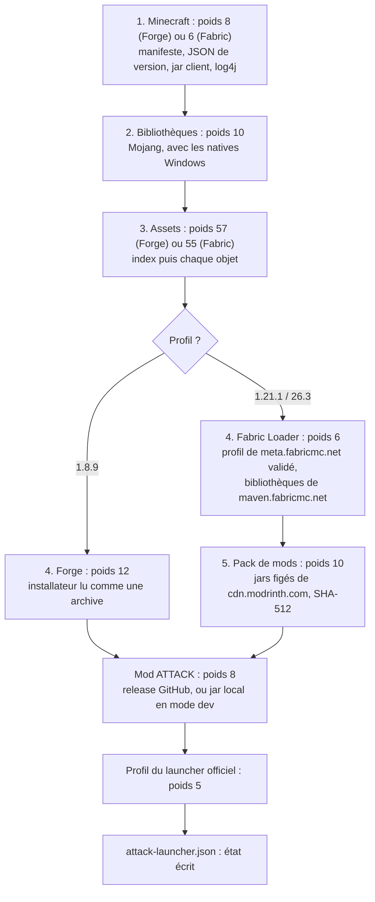
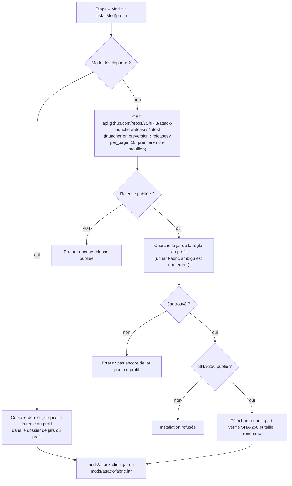
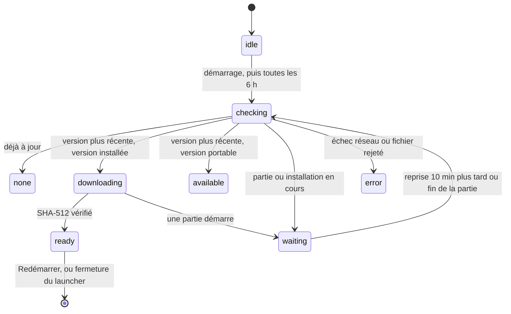

# Installation et mises à jour

[← Sommaire](Home.md)

## Les trois profils

Le launcher gère trois profils indépendants (catalogue dans `src/main/catalog.js`). Chacun a sa version de Minecraft,
son chargeur de mods, son dossier de jeu, son état d'installation et son profil dans le launcher officiel.

| | **1.8.9** | **1.21.1** | **26.3** |
| --- | --- | --- | --- |
| Identifiant | `forge-1.8.9` | `fabric-1.21.1` | `fabric-26.3` |
| Minecraft | 1.8.9 | 1.21.1 | 26.3 |
| Chargeur | Forge 11.15.1.2318 | Fabric Loader 0.19.5 | Fabric Loader 0.19.5 |
| Version dans `versions\` | `1.8.9-forge1.8.9-11.15.1.2318-1.8.9` | `fabric-loader-0.19.5-1.21.1` | `fabric-loader-0.19.5-26.3` |
| Java (composant Mojang) | 8 (`jre-legacy`) | 21 (`java-runtime-delta`) | 25 (`java-runtime-epsilon`) |
| Dossier de jeu par défaut | `%APPDATA%\.attack` | `%APPDATA%\.attack\profiles\fabric-1.21.1` | `%APPDATA%\.attack\profiles\fabric-26.3` |
| Jar du mod | `mods\attack-client.jar` | `mods\attack-fabric.jar` | `mods\attack-fabric.jar` |
| Profil du launcher officiel | `attack-client`, « ATTACK Client » | `attack-fabric-1.21.1`, « ATTACK 1.21.1 » | `attack-fabric-26.3`, « ATTACK 26.3 » |
| Pack de mods | `src/main/packs/forge-1.8.9.json` | `src/main/packs/fabric-1.21.1.json` | `src/main/packs/fabric-26.3.json` |
| OptiFine | copie du joueur (jamais téléchargé) | — | — |

Le profil 1.8.9 garde **exactement** son identifiant officiel (`attack-client`) et son dossier de jeu : un joueur qui
l'utilisait déjà ne perd rien. L'ancien réglage « dossier de jeu » (global) est repris tel quel pour ce profil lors de la
première lecture de `settings.json` (migration automatique).

## Ce qui est installé, et où

| Élément | Emplacement |
| --- | --- |
| Minecraft (JSON, jar, bibliothèques, ressources) | `%APPDATA%\.minecraft\versions\<version>`, `libraries`, `assets` (partagés entre les profils) |
| Chargeur de mods du profil | `%APPDATA%\.minecraft\versions\<version du profil>` et ses bibliothèques dans `libraries` |
| Dossier de jeu séparé (mods, réglages, captures, mondes) | un par profil, voir le tableau ci-dessus (modifiable dans Réglages, profil par profil) |
| Mod ATTACK | `<dossier de jeu>\mods\attack-client.jar` (1.8.9) ou `attack-fabric.jar` (Fabric) |
| Pack de mods | `<dossier de jeu>\mods\` : un jar par mod du pack |
| OptiFine du joueur (1.8.9) | `<dossier de jeu>\mods\OptiFine-1.8.9_*.jar` : copie de la sienne, suivie dans l'état |
| `options.txt` de départ (langue, et vidéo en Fabric) | `<dossier de jeu>\options.txt`, une fois par étape |
| État de l'installation (profil, versions, source du mod, SHA-256, pack et jars gérés, date) | `<dossier de jeu>\attack-launcher.json` |
| Profil du launcher officiel | fusionné dans `%APPDATA%\.minecraft\launcher_profiles.json` (copie `.bak` avant chaque écriture) |
| Java officiel de Mojang (lancement direct) | `%LOCALAPPDATA%\ATTACK Launcher\runtime\<composant>` : `jre-legacy`, `java-runtime-delta` ou `java-runtime-epsilon` |
| Natives du jeu (extraites au lancement) | `%APPDATA%\.minecraft\versions\<version du profil>\natives-attack` (26.x : sous-dossiers `java`, `jna`, `lwjgl`, `netty`) |
| Réglages, comptes, journal des mises à jour | `%APPDATA%\ATTACK Launcher\` (`settings.json`, `accounts.json`, `logs\updater.log`) |
| Mise à jour téléchargée, en attente | `%LOCALAPPDATA%\attack-launcher-updater` (dossier de cache d'`electron-updater`) |

Le **dossier de jeu séparé** évite tout mélange avec les autres mods de ton `.minecraft`. Ferme le launcher officiel
pendant l'installation : il peut réécrire `launcher_profiles.json`.

## Déroulé d'une installation

Le bouton **INSTALLER** (et **Vérifier / réparer l'installation**) lance `installer.install()` pour le **profil choisi**
sur l'accueil. La barre de progression est pondérée par étape (`STEPS_FORGE` et `STEPS_FABRIC`, `installer.js`).

1. **Minecraft** : le manifeste des versions (`piston-meta.mojang.com`) donne l'adresse et le SHA-1 du JSON de la
   version du profil (1.8.9, 1.21.1 ou 26.3) ; ce JSON est vérifié, puis le jar client (SHA-1 et taille) et la
   configuration log4j.
2. **Bibliothèques** : chaque fichier a son SHA-1 dans le JSON ; le chemin annoncé doit être celui que calcule le
   launcher à partir du nom Maven (sinon : « Chemin inattendu », `mojang.js:56-61`). Les natives Windows sont incluses.
3. **Assets** : l'index d'assets est vérifié par SHA-1, puis chaque objet est téléchargé depuis
   `resources.download.minecraft.net` à l'adresse dérivée de son hash, sans doublon, 8 téléchargements en parallèle.
4. **Forge** (profil 1.8.9) : l'installateur est téléchargé (SHA-1 lu dans le fichier `.sha1` publié à côté, sur Maven Forge), puis
   **ouvert comme une archive ZIP** : on y lit `install_profile.json` et on en extrait le jar `universal`. Aucun code de
   l'installateur n'est exécuté. L'identifiant de version doit être exactement celui attendu, et le nom du jar
   universal est contrôlé. Les bibliothèques Forge viennent de Maven Forge ou de Mojang uniquement (toute autre adresse
   de dépôt est refusée, `forge.js:31-36`), avec les checksums de l'`install_profile` ou le `.sha1` voisin.
   **Fabric Loader** (profils 1.21.1 et 26.3, `src/main/fabric.js`) : le profil de version est téléchargé depuis
   `https://meta.fabricmc.net/v2/versions/loader/<mc>/0.19.5/profile/json` (Fabric Loader est **épinglé** à 0.19.5). Il
   est validé strictement : identifiant `fabric-loader-0.19.5-<mc>`, héritage de la bonne version de Minecraft, classe
   principale `net.fabricmc.loader.impl.launch.knot.KnotClient`, bibliothèques uniquement sur `maven.fabricmc.net` ou
   `libraries.minecraft.net`, hash bien formés, options Java en **liste blanche** (une seule valeur exacte, une seule fois :
   `-DFabricMcEmu= net.minecraft.client.main.Main ` ; tout le reste, `-javaagent`, `-cp`, `-Djava.library.path`,
   `--add-opens`, `-Dfabric.addMods=`, `-Dfabric.gameJarPath=`... est refusé), aucun argument du jeu (la liste doit être vide ou absente), et `fabric-loader 0.19.5` présent. Le JSON écrit dans `versions\` est reconstruit à partir de ces seuls champs, avec les
   bibliothèques au format `downloads.artifact` (chemin, URL, SHA-1, taille) que le launcher officiel sait vérifier.
   Chaque bibliothèque est contrôlée par le hash le plus fort publié (SHA-512 pour asm et sponge-mixin) ; `fabric-loader`
   et `intermediary` n'en portent pas dans le profil : leur SHA-1 est **figé dans le catalogue** (`catalog.js`,
   `loader.pinnedSha1`), donc pas pris sur le serveur qui sert le jar ; à défaut, on prendrait le fichier `.sha1` publié à
   côté du jar sur le Maven de Fabric (`intermediary` n'existe pas pour 26.3). Un SHA-1 figé est **toujours** vérifié,
   même si le profil Fabric publie un hash pour cette bibliothèque : un hash du profil qui le contredit est refusé.
5. **Pack de mods** (les trois profils, `src/main/modpack.js`) : voir [Le pack de mods](#le-pack-de-mods-les-trois-profils), puis **OptiFine du joueur** (1.8.9) : voir [OptiFine pour la 1.8.9](#optifine-pour-la-189-la-copie-du-joueur).
6. **Mod** : voir [Mod ATTACK : d'où vient le jar ?](#mod-attack--doù-vient-le-jar-).
7. **Profil** : fusion dans `launcher_profiles.json` ([Fonctionnalités](Fonctionnalites.md#profil-du-launcher-officiel)).

Les fichiers déjà présents **avec le bon hash** ne sont pas retéléchargés : c'est ce qui rend « Vérifier / réparer »
rapide.

## Vérification des fichiers

| Fichier | Contrôle | Source du hash |
| --- | --- | --- |
| JSON de version, jar client, bibliothèques, log4j, index d'assets, objets d'assets | SHA-1 (et taille quand elle est publiée) | Manifestes officiels de Mojang |
| Runtime Java (`jre-legacy`, `java-runtime-delta`, `java-runtime-epsilon`) | SHA-1 de chaque fichier | Manifeste des runtimes de Mojang |
| Installateur Forge, bibliothèques Forge | SHA-1 | Fichier `.sha1` voisin sur Maven Forge, ou checksums de l'`install_profile` |
| Bibliothèques Fabric (asm, sponge-mixin…) | SHA-512 | Profil de version publié par `meta.fabricmc.net` |
| `fabric-loader`, `intermediary` | SHA-1 | Figé dans `catalog.js` (le profil n'en donne pas) ; à défaut, fichier `.sha1` voisin sur `maven.fabricmc.net` |
| Mods du pack (Fabric) | **SHA-512** et taille | Écrits dans `src/main/packs/<profil>.json` (relus sur Modrinth au moment de figer le pack), jamais demandés à l'API à l'exécution |
| Jar ATTACK (`attack-client` ou `attack-fabric`) | SHA-256 **obligatoire** et taille | Champ `digest` de GitHub pour l'asset, sinon un fichier `.sha256` ou `SHA256SUMS` joint à la release. Sans SHA-256, l'installation est **refusée** (`mod.js`) |
| Mise à jour du launcher | SHA-512 | `latest.yml`, publié avec la release |

Fonctionnement commun (`http.js`) : le fichier est écrit dans un `.part`, son hash est calculé pendant le
téléchargement, et il n'est renommé en fichier définitif que si le hash (et la taille) correspondent. Sinon le `.part`
est supprimé et l'installation s'arrête avec une erreur. Un téléchargement sans hash connu est refusé.

**Limite à connaître** : quand le hash vient du même serveur que le fichier (le `.sha1` de Maven Forge, le `digest` ou le
`.sha256` de GitHub), il protège contre un fichier abîmé ou tronqué, pas contre quelqu'un qui contrôlerait ce serveur
ou le compte GitHub du projet.

## Sources réseau autorisées

Le launcher n'ouvre **que** des adresses `https` dont l'hôte est dans `ALLOWED_HOSTS` (`constants.js:27-44`). Les
redirections sont suivies à la main et chaque adresse est vérifiée **avant** d'être contactée (`http.js:31-45`) : une
redirection vers un autre hôte est refusée (« Adresse refusée »).

| Hôte | Usage |
| --- | --- |
| `piston-meta.mojang.com`, `piston-data.mojang.com`, `launchermeta.mojang.com`, `launcher.mojang.com` | Manifestes, jar du jeu, runtime Java |
| `libraries.minecraft.net`, `resources.download.minecraft.net` | Bibliothèques et ressources du jeu |
| `maven.minecraftforge.net` | Forge et ses bibliothèques |
| `meta.fabricmc.net`, `maven.fabricmc.net` | Profil de version de Fabric Loader, ses bibliothèques et leurs `.sha1` |
| `cdn.modrinth.com` | Jars du pack de mods (adresses figées dans `src/main/packs/`). **Jamais** `api.modrinth.com` |
| `api.github.com`, `github.com`, `objects.githubusercontent.com`, `release-assets.githubusercontent.com` | Dernière release (jar du mod, SHA-256), page Releases |
| `login.microsoftonline.com` | Connexion Microsoft (code d'appareil, renouvellement) |
| `user.auth.xboxlive.com`, `xsts.auth.xboxlive.com` | Xbox Live et XSTS |
| `api.minecraftservices.com` | Jeton Minecraft, possession du jeu, profil, skin |
| `textures.minecraft.net` | Image du skin |

Autres adresses ouvertes, uniquement **par un clic de l'utilisateur dans le navigateur** (pas par le launcher lui-même) :
la page de validation Microsoft (`microsoft.com/link`, vérifiée avant ouverture, `main.js:373-380`), le dépôt GitHub, la page
Releases, et les deux liens d'aide Azure (`portal.azure.com`, `aka.ms/mce-reviewappid`).

Les mises à jour du launcher passent par `electron-updater`, qui fait ses propres requêtes (uniquement vers les releases
de ce dépôt : `github.com` et ses serveurs de fichiers) ; elles ne passent pas par `http.js`.

## Le pack de mods (les trois profils)

Chaque profil a un pack **figé** dans le dépôt : `src/main/packs/forge-1.8.9.json`, `fabric-1.21.1.json` et
`fabric-26.3.json`. Une entrée = un mod : nom, version, nom de fichier, adresse `cdn.modrinth.com`, SHA-512, SHA-1,
taille, **licence** et **auteur** du projet (lus sur Modrinth au moment de figer le pack, pour l'écran « Mods et licences »).
Le launcher **n'appelle jamais l'API Modrinth** : il télécharge seulement ces adresses.

### Les groupes du pack

Un mod du pack peut appartenir à un **groupe**, que le joueur active ou coupe avec un réglage **par profil** (appliqué à la
prochaine installation, bouton INSTALLER). Un jar qui sort du pack (groupe coupé) est retiré, jamais un jar du joueur.

| Groupe | Réglage | Par défaut | Profils | Mods |
| --- | --- | --- | --- | --- |
| *(aucun)* | | toujours installés | les 3 | mods de performance, bibliothèques |
| `pvp` | **Mods PvP (latence)** (`pvpMods`) | activé | 1.21.1, 26.3 | Crystal Optimizer, Anchor Optimizer, WalksyLib, **BetterHitReg**, **Complete Shield Fixes** |
| `optifine` | **Packs OptiFine** (`optifinePacks`) | activé | 1.21.1, 26.3 | **Continuity**, **Entity Texture Features**, **Entity Model Features** |
| `replay` | **Replay Mod** (`replayMod`) | coupé | les 3 | **Replay Mod** |
| *(optionnel)* | **Shaders (Iris)** (`shaders`) | coupé | 1.21.1, 26.3 | Iris Shaders |

Les mods des groupes `pvp` ne changent que ce que le client affiche ou anticipe (cristal retiré dès le coup, coup enregistré
avant le serveur, bouclier) : à couper sur un serveur qui les interdit. Les trois « packs OptiFine » lisent les packs de
ressources au format OptiFine (textures connectées, mobs, ciel) **sans OptiFine** : c'est la voie Fabric.

| Mod | 1.8.9 (Forge) | 1.21.1 | 26.3 |
| --- | --- | --- | --- |
| Phosphor Legacy (Forge, moteur d'éclairage) | 5 | — | — |
| Client Side Sounds | 1.1 | — | — |
| Fabric API | — | 0.116.17+1.21.1 | 0.164.0+26.3 |
| Sodium | — | 0.8.13 | 0.9.2 |
| Lithium | — | 0.15.4 | 0.26.2 |
| FerriteCore | — | 7.0.3 | 9.0.0 |
| ImmediatelyFast | — | 1.6.15+1.21.1 | 1.17.1+26.3 |
| Mod Menu | — | 11.0.5 | 21.0.0 |
| Entity Culling | — | 1.11.3 | 1.11.3 |
| More Culling (+ Cloth Config 15.0.140 / 26.3.159) | — | 1.0.10 | 1.9.0 |
| BadOptimizations | — | 2.4.1 | 2.4.1 |
| ModernFix | — | 5.25.1 | — (pas de version 26.3) |
| Krypton | — | 0.2.8 | 0.3.2 |
| Fast IP Ping | — | 1.0.12 | 1.0.12 |
| Server Pinger Fixer | — | 1.0.6 | 1.1.1 |
| Reflex AntiLag | — | 1.1.3 | 1.1.3 |
| Continuity (`optifine`) | — | 3.0.0+1.21 | 3.0.1+26.3 |
| Entity Texture Features (`optifine`) | — | 7.2.6 | 7.2.6 |
| Entity Model Features (`optifine`) | — | 3.3.12 | 3.3.12 |
| Crystal Optimizer (Marlow, `pvp`) | — | 2.0.0 | 2.0.0 |
| Anchor Optimizer (Walksy, + WalksyLib 2.0.4, `pvp`) | — | 1.3.0 | 1.3.0 |
| BetterHitReg (`pvp`) | — | 1.0.7 | 1.0.8-BETA |
| Complete Shield Fixes (`pvp`) | — | 2.1.0 | 2.1.0 |
| Replay Mod (`replay`) | 1.8.9-2.6.24 | 1-2.6.28 (1.21) | 26.3-2.6.28 |
| Iris Shaders (optionnel, réglage **Shaders**) | — | 1.8.14-beta.1 | 1.11.7 |

- **Pas de Dynamic FPS** : par défaut il descend à 1 FPS dès que la fenêtre perd le focus (60 FPS au survol), gênant
  avec un second écran, et il ne fait gagner aucun FPS en jeu.
- **Réglages de départ d'`options.txt`** (`src/main/gameoptions.js`), par **étapes** suivies par le drapeau `gameOptions`
  de `attack-launcher.json` (une étape faite n'est jamais refaite) :
  - étape 1, **profils Fabric seulement** : un dossier neuf reçoit un `options.txt` sans VSync, sans limite de FPS
    (`maxFps:260`), sans ombres d'entités, distance 10 ; dans un dossier existant, seules les valeurs par défaut de
    Minecraft `enableVsync:true` et `maxFps:120` sont remplacées ;
  - étape 2, **tous les profils, 1.8.9 comprise** : la **langue du launcher** (`lang:fr_fr` / `en_us` en Fabric,
    `lang:fr_FR` / `en_US` en 1.8.9) est écrite **seulement quand le launcher crée** `options.txt` (dossier de jeu neuf).
    Un `options.txt` existant garde sa langue : `en_us` peut être le choix d'un joueur qui joue en anglais exprès, rien ne
    le distingue de la valeur par défaut de Minecraft. Le menu ATTACK d'un dossier neuf sort ainsi en français ; le drapeau
    `gameOptions=2` est posé dans tous les cas (l'étape n'est pas refaite). Un dossier déjà à `gameOptions=1` ne refait pas
    l'étape 1.
  Un choix du joueur n'est jamais modifié.
- **Iris et Sodium vont ensemble** : en 1.21.1, Sodium 0.8.13 (dernière release, nouveau moteur de rendu) demande
  Iris 1.8.14-beta.1, seule version d'Iris pour Sodium 0.8 en 1.21.1 (publiée en juin 2026, pas de release stable
  depuis) ; Iris 1.8.8 (stable) ne marche qu'avec Sodium 0.6.x. En 26.3, Iris 1.11.7 déclare `sodium 0.9.x`
  (Sodium 0.9.2, qui casse `iris <= 1.11.2`).
- Mod Menu embarque déjà Text Placeholder API (dans `META-INF/jars`) : il n'y a pas de `placeholder-api` à côté.
- **Validation** (`modpack.validatePack`) : adresse `https` sur `cdn.modrinth.com` uniquement, SHA-512 de 128 caractères
  hexadécimaux, nom de fichier `^[\w.+-]+\.jar$` (jamais un chemin), l'adresse doit désigner exactement ce fichier, pas de
  doublon (même à la casse près), groupe parmi `pvp`, `optifine`, `replay`, licence (identifiant SPDX ou `LicenseRef-…`)
  et auteur courts. Les noms contenant `+` sont encodés `%2B` dans l'adresse.
- **Installation** : téléchargements en parallèle dans `<dossier de jeu>\mods\`, chacun vérifié par SHA-512 et taille. Iris
  n'est installé que si **Shaders (Iris)** est activé, et chaque groupe que si son réglage l'est.
- **Jars gérés** : la liste des jars posés par le launcher est gardée dans `attack-launcher.json` (`pack.managed`,
  écriture atomique : fichier temporaire puis renommage). À l'installation suivante, un jar géré qui n'est plus dans le pack
  (mod retiré, version changée, groupe coupé) est **supprimé**, après que tous les téléchargements ont réussi. Si un
  téléchargement échoue, les jars téléchargés pendant ce passage sont retirés (jamais deux versions du même mod côte à côte)
  et les anciens ne sont pas touchés ; si un ancien jar est verrouillé (jeu ouvert), il reste suivi et l'installation
  s'arrête avec un message qui demande de fermer le jeu. L'installation est refusée tant qu'une partie est ouverte dans le dossier
  de jeu de ce profil (lancée ici ou par le launcher officiel) ; une partie d'un autre profil ne bloque pas. Les jars que **tu** ajoutes à `mods\` ne sont **jamais**
  touchés, pas plus que le jar ATTACK ; un nom suspect dans l'état (chemin, autre extension) est ignoré.
- **État de l'accueil** : le voyant « Pack de mods » est vert quand chaque jar du pack voulu est présent avec la bonne taille
  et qu'aucun ancien jar géré ne traîne. Activer ou couper un groupe le repasse à « à installer » (et le réglage affiche
  « À appliquer ») jusqu'au prochain clic sur **INSTALLER** ; la page Mods propose alors **Installer maintenant**.
  `packGroups` (jars présents par groupe) alimente les pastilles « Appliqué / À appliquer / Désactivé ».
- **Dossier de jeu partagé** : un état sans `profileId` est attribué par `pack.id` (identifiant du profil qui a posé le pack,
  Forge 1.8.9 comme Fabric) ; un `pack` sans identifiant date d'avant les packs Forge et vient d'un profil Fabric.
- **Figer un pack** (développeurs) : `node scripts/resolve-pack.js` interroge l'API Modrinth, sélectionne exactement les
  numéros de version listés dans le script (`SPECS`, avec le chargeur de chaque profil), lit la licence et l'auteur de
  chaque projet et réécrit les trois fichiers ; `--check` compare sans rien écrire. Les dépendances « requises » hors pack
  sont signalées (aucune ne manque : Mod Menu embarque la sienne). À relire avant de commiter.

## OptiFine pour la 1.8.9 (la copie du joueur)

OptiFine ne peut pas être redistribué : le launcher **ne le télécharge jamais**. Pour le profil 1.8.9, il utilise seulement
la copie que le joueur a lui-même récupérée sur [optifine.net](https://optifine.net/downloads) (`src/main/optifine.js`) :

1. **Détection** : `.minecraft\libraries\optifine\OptiFine\1.8.9_*\OptiFine-1.8.9_*.jar` (laissée par l'installateur d'OptiFine,
   la variante la plus récente d'abord), puis `.minecraft\mods\*OptiFine*1.8.9*.jar`, ou le **fichier choisi** avec le bouton
   « Choisir le fichier… » de la carte OptiFine (Réglages, onglet Ce profil).
2. **Validation** avant toute copie : archive ZIP lisible, `META-INF/MANIFEST.MF` (1 Mo décompressé au plus : un jar piégé qui
   annonce plus, ou qui ment sur sa taille, est refusé sans geler le launcher) avec
   `TweakClass: optifine.OptiFineForgeTweaker`, nom contenant `1.8.9`. Un fichier refusé est expliqué (pas un .jar, mauvaise
   version, pas une archive, trop gros, pas OptiFine pour Forge).
3. **Copie** dans `<dossier de jeu>\mods\` (fichier temporaire puis renommage, empreinte SHA-256 relue), **suivie dans
   `attack-launcher.json`** (`optifine` : nom, origine, SHA-256, taille). Quand le réglage **OptiFine** est coupé, ou qu'une
   autre variante est choisie, **seule la copie du launcher est retirée** (et seulement si son empreinte n'a pas changé) ;
   un OptiFine que le joueur a mis lui-même dans `mods\` n'est jamais doublé ni supprimé. Si la copie d'origine disparaît
   (OptiFine désinstallé, fichier choisi effacé) alors que le réglage est actif, **le jar de `mods\` reste en place** :
   il marche, l'état est gardé et le profil reste prêt (JOUER, pas INSTALLER). Le launcher le compte (détail, nombre de mods,
   carte **Profil actuel**, page Mods) et l'affiche « déjà copié dans mods », pas « introuvable ».
4. **Rien trouvé** : un texte explique pourquoi (licence) et un bouton ouvre optifine.net dans le navigateur ; le jeu marche
   sans OptiFine. La page relit l'état au retour sur la fenêtre : un OptiFine installé entre-temps est trouvé tout seul.

Réglages par profil 1.8.9 : `optifine` (activé par défaut : la copie est utilisée si elle existe) et `optifineJar` (chemin
absolu choisi, vide = recherche automatique). ATTACK Client 2.5.4 et OptiFine HD U M5 marchent ensemble (0 mixin en échec).

## Crédits des mods

Réglages, onglet **Launcher**, bouton **Mods et licences** : la liste des mods du pack du profil choisi avec leur **auteur**,
leur **version** et leur **licence** (noms lisibles pour les identifiants Modrinth), et la phrase de crédit : les mods
appartiennent à leurs auteurs et restent sous leur licence, ils sont téléchargés sans modification depuis leur page
officielle sur Modrinth et vérifiés par SHA-512 ; OptiFine appartient à sp614x et n'est jamais embarqué. C'est l'une des
conditions de tr7zw pour Entity Culling.

## Mod ATTACK : d'où vient le jar ?

Chaque profil a sa **règle de nom exacte** (`src/main/catalog.js`) : le jar est choisi par cette règle, jamais « le
premier jar qui ressemble ».

| Profil | Règle du jar (release et build local) | Installé sous |
| --- | --- | --- |
| 1.8.9 | `attack-client*.jar` (sauf `-sources`, `-javadoc`, `-dev`, `-deobf`) | `mods/attack-client.jar` |
| 1.21.1 | `^attack-fabric-[0-9.]+\+mc1\.21\.1\.jar$` | `mods/attack-fabric.jar` |
| 26.3 | `^attack-fabric-[0-9.]+\+mc26\.3\.jar$` | `mods/attack-fabric.jar` |

Dossier des jars de développement : `Documents\pvp-essentials\build\libs` (1.8.9) et
`Documents\attack-client-fabric\versions\<mc>\build\libs` (Fabric), réglable par profil dans Réglages. Variables
d'environnement : `ATTACK_DEV_JAR_DIR` (1.8.9) et `ATTACK_DEV_JAR_DIR_FABRIC_1_21_1`, `ATTACK_DEV_JAR_DIR_FABRIC_26_3`.

Le mod est mis à jour à **chaque installation ou réparation** : il prend toujours la dernière release. Un launcher en
**préversion** (version avec un `-`, par exemple `0.5.0-beta.1`) lit à la place les 10 dernières releases
(`.../releases?per_page=10`) et prend la première qui n'est pas un brouillon, préversion comprise ; `releases/latest`
ignore les préversions et reste utilisé par tous les launchers en version normale. La mise à jour automatique du launcher
ne propose jamais de préversion (`allowPrerelease` reste faux).

## Java pour le lancement direct

Sans Java personnalisé, le launcher installe le runtime officiel que demande le JSON de version de Mojang
(`javaVersion.component`) : `jre-legacy` (Java 8) pour la 1.8.9, `java-runtime-delta` (Java 21) pour la 1.21.1,
`java-runtime-epsilon` (Java 25) pour la 26.3. Il lit le manifeste officiel des runtimes, choisit la plateforme (avec
repli de Windows ARM vers x64 si Mojang n'a pas publié le composant), télécharge chaque fichier avec son SHA-1, puis écrit
un marqueur `.attack-runtime.json` pour ne pas tout refaire. Le manifeste est relu à chaque lancement direct
(`runtime.js`). Un Java personnalisé choisi dans Réglages ne vaut que pour le profil où on l'a choisi.

## Lancement direct : deux formats de JSON de version

`game.js` sait lancer les deux formats de Mojang :

- **ancien** (1.8.9 + Forge) : `minecraftArguments`, une seule chaîne ;
- **moderne** (Fabric 1.21.1 et 26.3) : `arguments.jvm` et `arguments.game`, des listes dont les entrées sont des chaînes
  ou `{ rules, value }`. Les arguments du parent (Minecraft) viennent avant ceux de l'enfant (Fabric). Les règles sont
  évaluées pour Windows ; les options du launcher officiel (`--demo`, `--width`, `--quickPlay*`) sont exclues. Chaque
  variable (`${natives_directory}`, `${classpath}`, `${library_directory}`, `${clientid}`…) est remplacée **sans découper**
  l'argument : `-DFabricMcEmu= net.minecraft.client.main.Main ` reste un seul argument. `clientid` et `auth_xuid`, que le
  launcher n'a pas, sont vides ; un argument qui garderait une variable non résolue fait refuser le lancement.
  Pour 26.x, les natives vont dans les sous-dossiers `java`, `jna`, `lwjgl` et `netty` de `natives-attack`.

## Mises à jour automatiques du launcher

Le launcher se met à jour tout seul depuis la page [Releases](https://github.com/7ShIkI3/attack-launcher/releases) de ce
dépôt, avec `electron-updater` (`src/main/updates.js`). Le dépôt est public : **aucun jeton GitHub** n'est embarqué.

| Version | Comportement |
| --- | --- |
| Installée (`Setup.exe`, un désinstalleur est à côté de l'exe) | Vérifie au démarrage puis **toutes les 6 h**, télécharge en arrière-plan, affiche « Mise à jour X.Y.Z prête » avec **Redémarrer**. **Redémarrer** installe sans fenêtre d'installation puis relance. Si tu fermes le launcher sans cliquer, la mise à jour s'installe à la fermeture. |
| Portable | Ne peut pas se remplacer elle-même : affiche « Nouvelle version disponible » avec un bouton vers la page Releases ; tu télécharges la nouvelle version à la main. |
| Lancée depuis les sources | Désactivée. |

- **Jamais pendant une partie ni pendant une installation** : tant qu'ATTACK Client tourne (lancé par ce launcher **ou**
  par le launcher officiel) ou qu'une installation est en cours, rien n'est vérifié, téléchargé ni installé. Un
  téléchargement commencé est **annulé** si tu lances une partie, et reprend une fois le jeu fermé (nouvel essai toutes
  les 10 minutes, ou tout de suite à la fin d'une partie lancée par le launcher). « Redémarrer » est refusé pendant une
  partie, et la fermeture n'installe pas la mise à jour tant qu'une partie tourne (`updates.js:214-236`,
  `main.js:93-97`, `main.js:547-551`).
- **Détection d'une partie** (`game.js:178-197`) : le launcher liste en local les lignes de commande des processus
  `javaw.exe` / `java.exe` (PowerShell) et cherche la version du jeu de chaque profil (`1.8.9-forge1.8.9-11.15.1.2318-1.8.9`, `fabric-loader-0.19.5-1.21.1`, `fabric-loader-0.19.5-26.3`). Rien n'est
  enregistré ni envoyé. Si la détection échoue, elle répond « pas de partie » pour ne pas bloquer les mises à jour pour toujours.
- **Intégrité** : le fichier téléchargé est vérifié par son empreinte **SHA-512**, publiée dans `latest.yml` avec la
  release ; un fichier qui ne correspond pas est rejeté et supprimé. L'installateur n'étant pas signé, il n'y a **pas**
  de vérification de signature d'éditeur (aucun `publisherName` dans la configuration de mise à jour).
- **Réglages d'`electron-updater`** (`updates.js:112-117`) : téléchargement lancé par le launcher seulement quand rien ne tourne,
  pas de retour en arrière de version, pas de préversion, pas d'installateur web.
- **Journal** : `%APPDATA%\ATTACK Launcher\logs\updater.log` (l'ancien passe en `.old` au-delà de 1 Mo).
- La mise à jour automatique existe **depuis la 0.3.0** : avec une 0.2.0 ou plus ancienne, télécharge la 0.3.0 à la
  main une dernière fois.
- Chaque release doit contenir `latest.yml` et le `Setup.exe` qu'il désigne : voir [Publier une version](Publier-une-version.md).

Voir aussi : [Architecture](Architecture.md), [Vie privée et sécurité](Vie-privee-et-securite.md), [Dépannage](Depannage.md).
