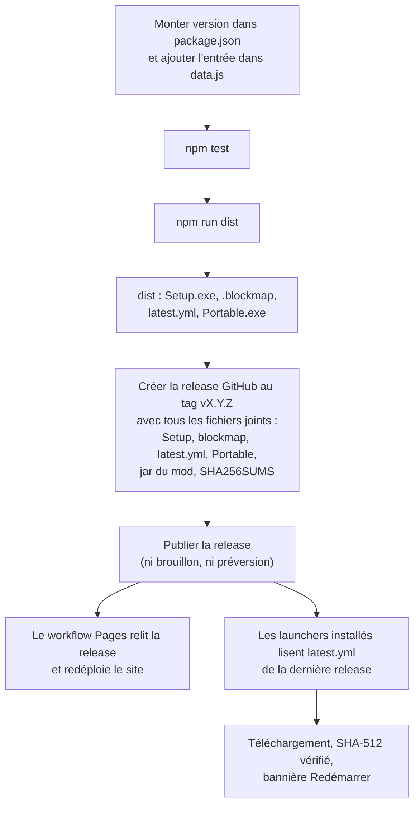

# Publier une version

[← Sommaire](Home.md)

Les releases de [7ShIkI3/attack-launcher](https://github.com/7ShIkI3/attack-launcher/releases) contiennent à la fois le
**launcher** et le **jar du mod ATTACK Client**. Cette page décrit la procédure actuelle (faite à la main : aucune
publication de release n'est automatisée, `npm run dist` ne publie rien ; seul le redéploiement du site se fait tout seul) et la création de l'application Azure.

## Publier une version du launcher

1. **Monte `version`** dans `package.json` (par exemple `0.5.1`). Ajoute aussi l'entrée « Launcher 0.5.1 » en tête de
   `CHANGELOG` dans `src/renderer/data.js` : c'est l'historique affiché sur la page d'accueil.
2. Lance `npm test`, puis **`npm run dist`**. Les fichiers sont créés dans `dist/` :
   `ATTACK-Launcher-Setup-<version>.exe`, son `.blockmap`, `latest.yml` et `ATTACK-Launcher-Portable-<version>.exe`.
3. Crée la release GitHub au tag `v<version>` (par exemple `v0.5.1`) **avec tous ses fichiers déjà joints**, puis publie-la
   (ni brouillon, ni préversion) : soit `gh release create v<version> <fichiers>` en une commande, soit un **brouillon** auquel
   tu joins les fichiers avant de cliquer sur « Publier ». La publication lance le workflow du site (étape 6), qui lit la
   release à ce moment-là : des fichiers joints après coup peuvent arriver trop tard. Joins-y, depuis `dist/` :
   - `ATTACK-Launcher-Setup-<version>.exe` ;
   - `ATTACK-Launcher-Setup-<version>.exe.blockmap` : permet aux versions suivantes de ne télécharger que ce qui a changé ;
   - `latest.yml` : version, nom et SHA-512 de l'installateur, lus par les launchers déjà installés ;
   - comme avant : `ATTACK-Launcher-Portable-<version>.exe` et `SHA256SUMS` ;
   - les **jars du mod**, un par profil (voir « Publier le mod » ci-dessous) : `attack-client-<version>.jar` pour la 1.8.9 et
     `attack-fabric-<version>+mc1.21.1.jar`, `attack-fabric-<version>+mc26.3.jar` pour Fabric.
4. **Chaque** release doit contenir `latest.yml` et le `Setup.exe` qu'il désigne (avec son `.blockmap`), **même une release
   qui ne change que le mod** (joins alors à nouveau ceux de la version actuelle du launcher) : les launchers lisent la
   **dernière** release. Sans eux, ils notent une erreur dans `updater.log` et ne proposent rien, sans autre conséquence.
   Le site est plus strict : il lit lui aussi la dernière release et exige un seul `Setup` et un seul `Portable` dont la version est
   celle du tag. Une release « mod seul » dont le tag n'est pas la version du `Setup` joint fait donc échouer la génération du
   site (voir l'étape 6) : la page déjà en ligne ne change pas, jusqu'à la prochaine release du launcher.
5. Le `.exe` n'est pas signé : SmartScreen avertira au premier lancement (voir [Dépannage](Depannage.md#windows-smartscreen)).
   Tu peux publier le SHA-256 de chaque fichier (`SHA256SUMS`) pour que les joueurs le comparent. Le fichier `SHA256SUMS`
   n'est pas produit par `npm run dist` : il se prépare à part. Quand la release porte plusieurs jars, `SHA256SUMS` doit
   avoir **une ligne par fichier** (`<sha256>  <nom exact>`) : le launcher y cherche la ligne portant le nom du jar de son
   profil et refuse de prendre le hash d'un autre fichier.
6. **Le site** : à la publication de la release, le workflow Pages (`.github/workflows/pages.yml`, voir
   [Développement](Developpement.md#site-web)) redéploie le site, [7shiki3.github.io/attack-launcher](https://7shiki3.github.io/attack-launcher/)
   et sa version anglaise (`/en/`). Il n'y a rien à faire à la main, mais il faut contrôler le résultat (ci-dessous).
   **Publie la release avant d'activer GitHub Pages**, et avant de fusionner une page qui décrit la nouvelle version : le site
   montre le Setup de la dernière release, et décrit (nouveautés, fonctions) la version du dépôt. La génération (`--strict`)
   échoue, sans déployer, si la dernière release est plus ancienne que la `version` de `package.json` (par exemple le site de
   la 0.6.0 face à une dernière release 0.5.16), si ses fichiers manquent ou si la version du `Setup` n'est pas celle du tag :
   elle relit alors la release 6 fois, à 20 secondes d'intervalle, puis s'arrête. La page en ligne reste telle quelle ;
   une fois la release complète, relance le workflow (onglet Actions, « Site », « Run workflow »).

À vérifier après publication :

- ouvre le site (en français et sous `/en/`) et clique sur le bouton **Télécharger** : il doit mener au fichier de la release que tu
  viens de publier. Si le site ne semble pas à jour, regarde le workflow Pages dans l'onglet Actions de GitHub ;
- `npm run update-test -- <dossier>` valide la chaîne de mise à jour sur une version de test (sans GitHub) ;
- `npm run install-test -- <dossier> --release` installe avec le vrai jar de la dernière release et recontrôle tous les hash
  ; ajoute `--profile fabric-1.21.1` ou `--profile fabric-26.3` pour les profils Fabric ([Développement](Developpement.md)) ;
- `node scripts/resolve-pack.js --check` compare les packs figés avec ce que Modrinth publie aujourd'hui.

> La mise à jour automatique existe **depuis la 0.3.0** : une 0.2.0 ou plus ancienne ne la propose pas ; il faut
> télécharger la 0.3.0 à la main une dernière fois.

## Publier le mod

Chaque profil prend **son** jar dans la **dernière release** GitHub de ce dépôt, choisi par une règle de nom exacte
(`src/main/catalog.js`) :

| Profil | Nom du jar dans la release |
| --- | --- |
| 1.8.9 (Forge) | `attack-client*.jar` (les jars `-sources`, `-javadoc`, `-dev` et `-deobf` sont ignorés), par exemple `attack-client-2.3.0.jar` |
| 1.21.1 (Fabric) | `attack-fabric-<version>+mc1.21.1.jar`, par exemple `attack-fabric-3.0.0+mc1.21.1.jar` |
| 26.3 (Fabric) | `attack-fabric-<version>+mc26.3.jar`, par exemple `attack-fabric-3.0.0+mc26.3.jar` |

Un jar Fabric est reconnu seulement s'il suit exactement `^attack-fabric-[0-9.]+\+mc<version de Minecraft>\.jar$` : le jar
d'une autre version de Minecraft, un `-sources` ou un `attack-client` ne sont jamais installés dans un profil Fabric, et
deux jars différents pour la même version de Minecraft dans une release sont une **erreur** (jamais un choix au hasard).
Si la release n'a pas (encore) de jar pour le profil, l'installation de ce profil s'arrête avec un message clair ; les
autres profils ne sont pas touchés.

Le launcher exige le **SHA-256** de chaque jar :

- celui que GitHub calcule pour chaque fichier de release (champ `digest`), **ou**, à défaut,
- un fichier `<jar>.sha256` joint à la release (un `SHA256SUMS` ou `sha256.txt` convient aussi, avec une ligne par jar).

**Sans SHA-256, l'installation est refusée** (`src/main/mod.js`).

Le mod Forge est construit dans le dépôt `attack-client`, le mod Fabric dans `attack-client-fabric` (un jar par version
de Minecraft, `versions/<mc>/build/libs`). Comme le launcher réinstalle le mod à chaque installation ou réparation, un
joueur reçoit une nouvelle version du mod en cliquant sur « Vérifier / réparer l'installation ». Tant qu'aucune release du
mod n'existe, le mode développeur permet de copier un jar local ([Fonctionnalités](Fonctionnalites.md#mode-développeur)).

## Mettre à jour un pack de mods

Les packs vivent dans le dépôt (`src/main/packs/forge-1.8.9.json`, `fabric-1.21.1.json`, `fabric-26.3.json`) : les adresses et les hash sont
**écrits à l'avance**, pas résolus par le launcher. Pour changer une version :

1. Modifie les numéros de version dans `scripts/resolve-pack.js` (le `versionNumber` est le numéro **exact** de Modrinth).
2. `node scripts/resolve-pack.js fabric-1.21.1` réécrit le fichier (URL `cdn.modrinth.com`, SHA-512, SHA-1, taille).
3. **Relis le résultat** : compatibilité Iris / Sodium (`depends` et `breaks` dans le `fabric.mod.json` d'Iris et de
   Sodium), dépendances requises non embarquées, version de Minecraft.
4. `npm test`, puis `npm run install-test -- <dossier> --profile fabric-1.21.1 --cycle` et
   `npm run launch-test -- <dossier> --profile fabric-1.21.1`. Fais de même pour 26.3, puis publie une nouvelle version du
   launcher : le pack fait partie de son code.

## Créer l'app Azure (une seule fois, pour qui publie le launcher)

**Les joueurs n'ont rien à configurer** : le launcher utilise par défaut l'app Azure officielle d'ATTACK Launcher (ID
client `b904aac8-33e3-4ee6-a905-912a72de4859`, `src/main/settings.js:18`). Les étapes ci-dessous servent seulement si tu publies
ta propre version du launcher ; son ID se met alors dans **Réglages → ID client Azure** ou dans la variable
d'environnement `ATTACK_MS_CLIENT_ID`.

Mojang exige que chaque launcher utilise **sa propre application Azure, validée par Mojang**. Tant qu'elle n'est pas
validée, la connexion échoue à l'étape Minecraft (erreur 403 « Invalid app registration »). Procédure reprise de celle,
éprouvée, de [HeliosLauncher](https://github.com/dscalzi/HeliosLauncher/blob/master/docs/MicrosoftAuth.md) et de
[minecraft.wiki](https://minecraft.wiki/w/Microsoft_authentication).

1. **Annuaire obligatoire.** On ne peut plus créer d'app hors d'un annuaire Microsoft Entra. Si le portail ne t'en propose
   pas, crée un **compte Azure gratuit** : une carte bancaire est demandée pour vérifier ton identité, **sans aucun
   prélèvement**.
2. Sur [portal.azure.com](https://portal.azure.com) : **Microsoft Entra ID** → **Inscriptions d'applications** →
   **Nouvelle inscription**. Nom : « ATTACK Launcher » ; types de comptes : **Comptes dans un annuaire organisationnel et
   comptes Microsoft personnels** ; pas d'URI de redirection à la création.
3. **Authentification** → **Ajouter une plateforme** → **Applications mobiles et de bureau**, avec l'URI
   `https://login.microsoftonline.com/common/oauth2/nativeclient`.
4. Toujours dans **Authentification**, **Paramètres avancés** : **Autoriser les flux de clients publics** = **Oui**
   (indispensable pour la connexion par code), puis **Enregistrer**. **Aucun secret client** n'est nécessaire.
5. Sur la page **Vue d'ensemble**, copie l'**ID d'application (client)** (format `xxxxxxxx-xxxx-xxxx-xxxx-xxxxxxxxxxxx`)
   dans **Réglages → ID client Azure** du launcher, ou dans la variable d'environnement `ATTACK_MS_CLIENT_ID`. Ce n'est
   **pas un secret**.
6. Remplis le formulaire Mojang [aka.ms/mce-reviewappid](https://aka.ms/mce-reviewappid). Il demande l'**ID client** **et**
   l'**ID de l'annuaire (tenant)**, tous deux sur la page **Vue d'ensemble**. Après l'accord, compte **jusqu'à 24 h** avant
   que la connexion fonctionne.

> **Soyons francs :** l'accord de Mojang peut être lent, et il peut **ne jamais arriver** pour un petit projet. Tant qu'il
> n'est pas obtenu, rien n'est cassé : sans compte connecté, **JOUER** garde la voie du launcher officiel (profil
> « ATTACK Client » présélectionné).

Côté code, toutes les requêtes OAuth passent par le tenant `consumers` (`login.microsoftonline.com/consumers/...`),
jamais par `common` ni par l'ID de l'annuaire (`src/main/constants.js:51-60`). Le launcher reprend ces étapes
dans la carte « Connexion Microsoft à configurer » de la page **Compte**, affichée seulement quand aucun ID client n'est disponible.

Voir aussi : [Comptes et skin](Comptes-et-skin.md), [Installation et mises à jour](Installation-et-mises-a-jour.md).
