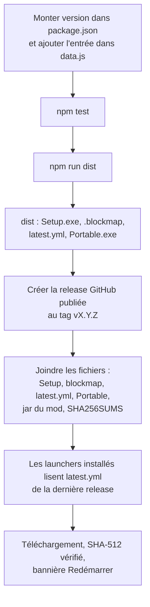

# Publier une version

[← Sommaire](Home.md)

Les releases de [7ShIkI3/attack-launcher](https://github.com/7ShIkI3/attack-launcher/releases) contiennent à la fois le
**launcher** et le **jar du mod ATTACK Client**. Cette page décrit la procédure actuelle (faite à la main : aucune
publication n'est automatisée, `npm run dist` ne publie rien) et la création de l'application Azure.

## Publier une version du launcher

1. **Monte `version`** dans `package.json` (par exemple `0.4.1`). Ajoute aussi l'entrée « Launcher 0.4.1 » en tête de
   `CHANGELOG` dans `src/renderer/data.js` : c'est l'historique affiché sur la page d'accueil.
2. Lance `npm test`, puis **`npm run dist`**. Les fichiers sont créés dans `dist/` :
   `ATTACK-Launcher-Setup-<version>.exe`, son `.blockmap`, `latest.yml` et `ATTACK-Launcher-Portable-<version>.exe`.
3. Crée une release GitHub **publiée** (ni brouillon, ni préversion) au tag `v<version>` (par exemple `v0.4.1`) et joins-y,
   depuis `dist/` :
   - `ATTACK-Launcher-Setup-<version>.exe` ;
   - `ATTACK-Launcher-Setup-<version>.exe.blockmap` : permet aux versions suivantes de ne télécharger que ce qui a changé ;
   - `latest.yml` : version, nom et SHA-512 de l'installateur, lus par les launchers déjà installés ;
   - comme avant : `ATTACK-Launcher-Portable-<version>.exe`, le jar du mod et `SHA256SUMS`.
4. **Chaque** release doit contenir `latest.yml` et le `Setup.exe` qu'il désigne (avec son `.blockmap`), **même une release
   qui ne change que le mod** (joins alors à nouveau ceux de la version actuelle du launcher) : les launchers lisent la
   **dernière** release. Sans eux, ils notent une erreur dans `updater.log` et ne proposent rien, sans autre conséquence.
5. Le `.exe` n'est pas signé : SmartScreen avertira au premier lancement (voir [Dépannage](Depannage.md#windows-smartscreen)).
   Tu peux publier le SHA-256 de chaque fichier (`SHA256SUMS`) pour que les joueurs le comparent. Le fichier `SHA256SUMS`
   n'est pas produit par `npm run dist` : il se prépare à part.

À vérifier après publication :

- `npm run update-test -- <dossier>` valide la chaîne de mise à jour sur une version de test (sans GitHub) ;
- `npm run install-test -- <dossier> --release` installe avec le vrai jar de la dernière release et recontrôle tous les hash
  ([Développement](Developpement.md)).

> La mise à jour automatique existe **depuis la 0.3.0** : une 0.2.0 ou plus ancienne ne la propose pas ; il faut
> télécharger la 0.3.0 à la main une dernière fois.

## Publier le mod

Le launcher prend le jar `attack-client*.jar` de la **dernière release** GitHub de ce dépôt (les jars `-sources`,
`-javadoc`, `-dev` et `-deobf` sont ignorés) et exige son **SHA-256** :

- celui que GitHub calcule pour chaque fichier de release (champ `digest`), **ou**, à défaut,
- un fichier `attack-client-x.y.z.jar.sha256` joint à la release (un `SHA256SUMS` ou `sha256.txt` convient aussi).

**Sans SHA-256, l'installation est refusée** (`src/main/mod.js:28`).

Le mod lui-même est construit dans le dépôt `attack-client`. Comme le launcher réinstalle le mod à chaque
installation ou réparation, un joueur reçoit une nouvelle version du mod en cliquant sur « Vérifier / réparer
l'installation ». Tant qu'aucune release du mod n'existe, le mode développeur permet de copier un jar local
([Fonctionnalités](Fonctionnalites.md#mode-développeur)).

## Créer l'app Azure (une seule fois, pour qui publie le launcher)

**Les joueurs n'ont rien à configurer** : le launcher utilise par défaut l'app Azure officielle d'ATTACK Launcher (ID
client `b904aac8-33e3-4ee6-a905-912a72de4859`, `src/main/settings.js:18`). Les étapes ci-dessous servent seulement si tu publies
ta propre version du launcher ; son ID se met alors dans **Réglages → ID client Azure** ou dans la variable
d'environnement `ATTACK_MS_CLIENT_ID`.

Mojang exige que chaque launcher utilise **sa propre application Azure, validée par Mojang**. Tant qu'elle n'est pas
validée, la connexion échoue à l'étape Minecraft (erreur 403 « Invalid app registration »). Procédure reprise de celle,
éprouvée, de [HeliosLauncher](https://github.com/dscalzi/HeliosLauncher/blob/master/docs/MicrosoftAuth.md) et de
[minecraft.wiki](https://minecraft.wiki/w/Microsoft_authentication).

1. **Annuaire obligatoire.** On ne peut plus créer d'app hors d'un annuaire Microsoft Entra. Si le portail ne t'en propose
   pas, crée un **compte Azure gratuit** : une carte bancaire est demandée pour vérifier ton identité, **sans aucun
   prélèvement**.
2. Sur [portal.azure.com](https://portal.azure.com) : **Microsoft Entra ID** → **Inscriptions d'applications** →
   **Nouvelle inscription**. Nom : « ATTACK Launcher » ; types de comptes : **Comptes dans un annuaire organisationnel et
   comptes Microsoft personnels** ; pas d'URI de redirection à la création.
3. **Authentification** → **Ajouter une plateforme** → **Applications mobiles et de bureau**, avec l'URI
   `https://login.microsoftonline.com/common/oauth2/nativeclient`.
4. Toujours dans **Authentification**, **Paramètres avancés** : **Autoriser les flux de clients publics** = **Oui**
   (indispensable pour la connexion par code), puis **Enregistrer**. **Aucun secret client** n'est nécessaire.
5. Sur la page **Vue d'ensemble**, copie l'**ID d'application (client)** (format `xxxxxxxx-xxxx-xxxx-xxxx-xxxxxxxxxxxx`)
   dans **Réglages → ID client Azure** du launcher, ou dans la variable d'environnement `ATTACK_MS_CLIENT_ID`. Ce n'est
   **pas un secret**.
6. Remplis le formulaire Mojang [aka.ms/mce-reviewappid](https://aka.ms/mce-reviewappid). Il demande l'**ID client** **et**
   l'**ID de l'annuaire (tenant)**, tous deux sur la page **Vue d'ensemble**. Après l'accord, compte **jusqu'à 24 h** avant
   que la connexion fonctionne.

> **Soyons francs :** l'accord de Mojang peut être lent, et il peut **ne jamais arriver** pour un petit projet. Tant qu'il
> n'est pas obtenu, rien n'est cassé : sans compte connecté, **JOUER** garde la voie du launcher officiel (profil
> « ATTACK Client » présélectionné).

Côté code, toutes les requêtes OAuth passent par le tenant `consumers` (`login.microsoftonline.com/consumers/...`),
jamais par `common` ni par l'ID de l'annuaire (`src/main/constants.js:51-60`). Le launcher reprend ces étapes
dans la carte « Connexion Microsoft à configurer » de la page **Compte**, affichée seulement quand aucun ID client n'est disponible.

Voir aussi : [Comptes et skin](Comptes-et-skin.md), [Installation et mises à jour](Installation-et-mises-a-jour.md).
